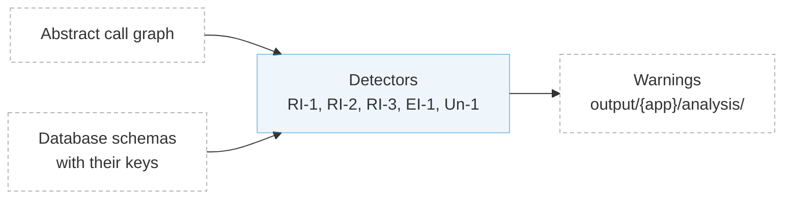

# Detection of Problematic Patterns

## Overview

The detection of problematic patterns is the fourth and last step of Aletheia. It walks each request through the [abstract call graph](inter-microservice-analysis.md) again, now with the primary keys, unique fields and foreign keys found by the [schema extraction](schema-extraction.md), and checks the database operations of each request against the five patterns described in [What Aletheia Detects](../patterns.md). Each match is reported as a warning.



See [Reading Detection Warnings](../4-formats/reading-warnings.md) for how to read the warnings.

<!--

## Implementation Details

The detection works in three parts:

| Stage | What it does |
| ----- | ------------ |
| [Checking each request](#checking-each-request) | Passes every database operation of each request to the detectors |
| [Pattern implementations](#pattern-implementations) | One detector per pattern, which looks for operations that can break the constraint it covers |
| [Outputs](#outputs) | The warnings of each detector, saved in one file per pattern |

### Checking Each Request

Aletheia walks the graph once per entry point, which corresponds to one client request, following service calls in depth, as in the [inter-microservice analysis](inter-microservice-analysis.md#tainting-the-abstract-call-graph). The `Run` methods of background services are not walked as requests of their own: they are reached through the queues they read from.

For every database call along the way, each detector is notified of the read, write, update or delete, together with the fields it touches. A detector keeps track of these operations within a request and across requests, and reports a warning when they match its pattern. For example, the RI-1 detector looks for a delete whose record is still referenced by a foreign key from another database that the same request does not delete.

<details markdown>
<summary>Implementation: passing database operations to the detectors</summary>

```go title="internal/analysis/system-level/detection/iterator.go" linenums="225" hl_lines="5 7 9 11"
--8<-- "internal/analysis/system-level/detection/iterator.go:225:238"
```

</details>

### Pattern Implementations

Integrity violations are detected by searching for the following patterns, formalized in our paper and implemented in [`internal/analysis/system-level/detection/constraints/`](https://github.com/aletheia-microservices/aletheia/tree/main/internal/analysis/system-level/detection/constraints/):

| ID   | Constraint            | Problematic Pattern          | Implementation Package                                                       |
| ---- | --------------------- | ---------------------------- | ---------------------------------------------------------------------------- |
| [RI-1](../patterns.md#ri-1-referential-integrity-absence-of-cascading-deletes) | Referential integrity | Absence of cascading effects | `internal/analysis/system-level/detection/constraints/foreignkeycascade`     |
| [RI-2](../patterns.md#ri-2-referential-integrity-concurrent-operations) | Referential integrity | Concurrent operations        | `internal/analysis/system-level/detection/constraints/foreignkeyconcurrency` |
| [RI-3](../patterns.md#ri-3-referential-integrity-uncoordinated-replication) | Referential integrity | Uncoordinated replication    | `internal/analysis/system-level/detection/constraints/keycoordination`       |
| [EI-1](../patterns.md#ei-1-entity-integrity-uncoordinated-replication) | Entity integrity      | Uncoordinated replication    | `internal/analysis/system-level/detection/constraints/keycoordination`       |
| [Un-1](../patterns.md#un-1-uniqueness-conflicting-writes) | Uniqueness            | Conflicting writes           | `internal/analysis/system-level/detection/constraints/uniquenessconcurrency` |

> [!NOTE]
> Refer to our paper for the formal definitions of these patterns.

### Outputs

Each detector saves its warnings in `output/{app}/analysis/`:

| Pattern | File |
| ------- | ---- |
| RI-1 | `foreign-key-cascade.txt` |
| RI-2 | `foreign-key-concurrency.txt` |
| RI-3 | `foreign-key-coordination.txt` |
| EI-1 | `primary-key-coordination.txt` |
| Un-1 | `uniqueness-concurrency.txt` |

See [Reading Detection Warnings](../4-formats/reading-warnings.md) for how to read them, and [Suppressing Detection Warnings](../3-usage/suppressing-warnings.md) for how to hide false positives.

-->
