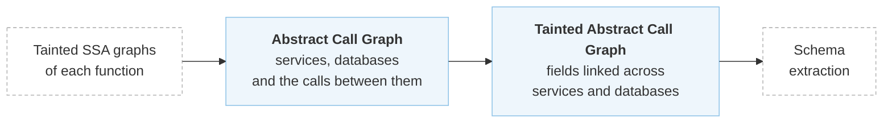
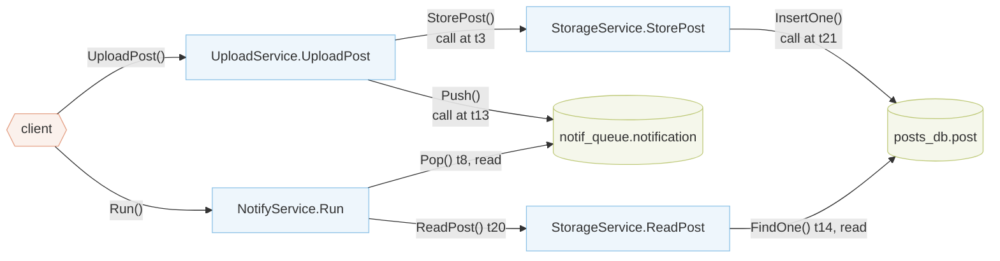
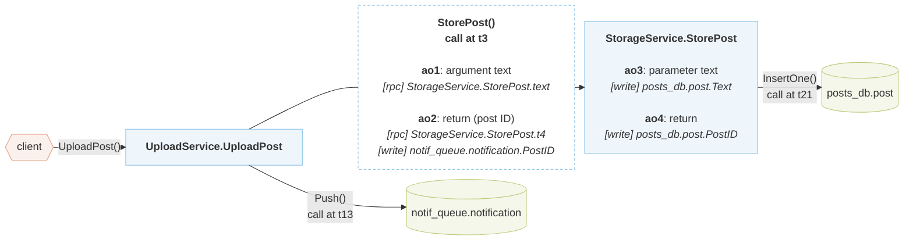
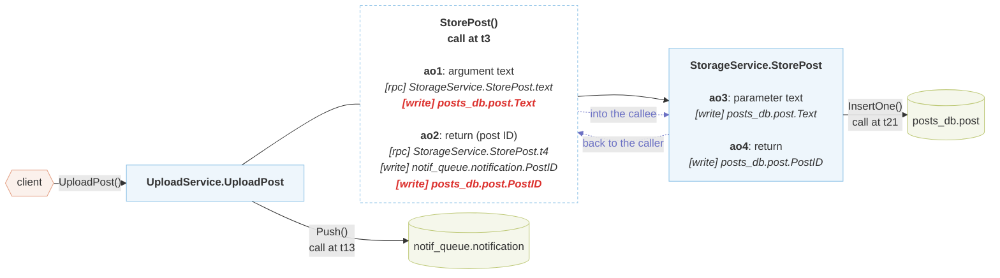

# Inter-microservice Analysis

## Overview

The inter-microservice analysis is the second step of Aletheia. The [intra-procedural analysis](intra-procedural-analysis.md) found, inside each service, which database fields and service calls each value flows into, but it stops at the boundaries of each service. In postnotification, it finds that `StorageService.StorePost` writes the value it returns to `posts_db.post.PostID`, and that `UploadService.UploadPost` pushes the value returned by its call to `StorePost` to `notif_queue.notification.PostID`, but not that the two are the same value. This step follows values across services to connect such operations.

Continuing the SSA taint analysis across services does not scale, because it would mean analyzing the SSA graphs of all services together, and a large application can have thousands of them. Instead, Aletheia moves to a higher level of abstraction, the **abstract call graph**. For each service, this graph keeps only its interaction points, which are the service calls and database operations it makes, and the values involved in them, with the taints that the SSA graphs found for them. This is all that is needed to find the [problematic patterns](../patterns.md), even when they span several services.

Below is a high-level representation of postnotification, but not yet its abstract call graph. It shows the services and databases of the application and the calls between them, with the timestamp of each call, that is, the SSA name of the call in its function. Each path from the client follows one client request through the services and databases it can reach:

`NotifyService.Run` is a background service that pops the notifications that `UploadService.UploadPost` pushes to `notif_queue`. Through the queue, one service triggers another. Aletheia does not walk `Run` on its own, but walks it as a new request each time a request pushes a message to the queue it pops from.

### Building the Abstract Call Graph

The nodes of the abstract call graph are the service methods (e.g., `StorageService.StorePost`) and the databases (e.g., `posts_db.post`), under a `client` node at the root. The edges are the calls between them:

- from the client to a service method, for each **entry point** of the application
- from a service method to another, for each **service call**
- from a service method to a database, for each **database operation**, with its type (write, update, read or delete)

Below is the **abstract call graph** of the request `UploadPost()` before it is walked, with four of the values involved in its calls. The dashed box is the edge of the call to `StorePost`:

The values involved in each call are **abstract objects**, which hold the taints that the intra-procedural analysis found for them. The parameters and returns of a service method are objects of its node, and the arguments and returns at each call are objects of the call's edge. In the figure above, `ao1` and `ao2` are objects of the edge of the call to `StorePost`, and `ao3` and `ao4` are objects of the node of `StorePost`.

### Tainting the Abstract Call Graph

So far, the taints of each object only describe what happens inside one service. To carry them across services, Aletheia walks the graph from each entry point, once per client request, following each call in depth:

- **Into the callee.** The taints of each argument of the call are copied to the matching parameter of the called method.
- **Back to the caller.** Once the called method has been walked, the taints of its parameters and returns are copied to the call's arguments and returns.

An object that gets new taints carries them on to the other service and database calls it flows into. When an object ends up with taints from operations on two different databases, the same value is stored in both, so the two databases depend on each other. The next step, the [schema extraction](schema-extraction.md), turns this dependency into a foreign key.

Below is the **abstract call graph** of the request `UploadPost()` during the walk, with the same four abstract objects. It goes through the steps listed under it one at a time, and the taints that each step adds are in bold red. The dotted violet arrows show where the walk copies taints, and are not edges of the graph.

> [!TIP]
> This diagram is interactive. Use the buttons under it or click a step to move through it.

1. The walk starts at `UploadService.UploadPost`. Before the walk, the edge of its call to `StorePost` holds the taints found in `UploadPost`, which show that the text (`ao1`) is only passed to `StorePost` and that the returned post ID (`ao2`) is pushed to the queue. The node of `StorePost` holds the taints found in `StorePost`, which show that it writes the text it receives (`ao3`) and the post ID it returns (`ao4`) to `posts_db`.
2. Into the callee, the taints of `ao1` are copied to `ao3`. `ao1` holds no database taint, since `UploadPost` does not store the text anywhere, so `ao3` gets nothing new. If `UploadPost` also pushed the text to the queue, `ao3` would now show it.
3. Back to the caller, the taints of `ao3` and `ao4` are copied to `ao1` and `ao2`. They show that the text and the post ID returned by `StorePost` were written to `posts_db` during the call, at `t3`, before `UploadPost` pushes the post ID to the queue, at `t13`.
4. `ao2` now holds writes to two databases, so the post ID links them. From this link, the [schema extraction](schema-extraction.md) infers that `notif_queue.notification.PostID` references `posts_db.post.PostID`. The text is only written to `posts_db`, so `ao1` links nothing.

The walk then follows the queue into `NotifyService.Run`, where the popped notification gets the taints of the pushed one. `Run` reads the post ID from the notification and then reads the post with it. Combined with the foreign key on the post ID, this is the [RI-3](../patterns.md#ri-3-referential-integrity-uncoordinated-replication) violation that Aletheia reports for postnotification.

The next step, the [schema extraction](schema-extraction.md), turns the linked fields into foreign keys.
