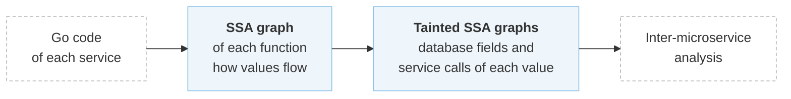
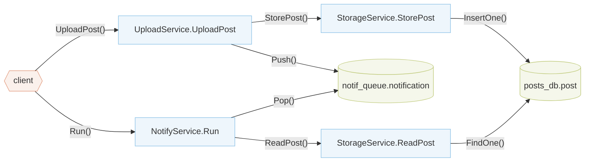
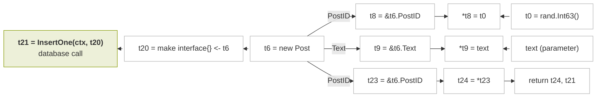
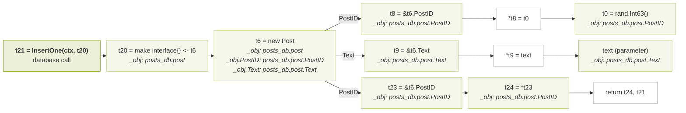

# Intra-procedural Analysis

## Overview

The intra-procedural analysis is the first step of Aletheia. To infer foreign keys and find the [problematic patterns](../patterns.md), Aletheia needs to know where the values used in database operations come from. For example, it needs to know that the post ID pushed to a queue is the same value that another service wrote to its database. This step answers that question inside each function. For every value of a function, it records which **database fields** the value is written to or read from, and which **service calls** it is passed to or returned from.

It works in two stages. It first turns the code of each function into an **SSA graph**, which shows how values flow from one instruction to the next. It then **taints** the graph by marking the values used in database and service calls and spreading these marks to every value they flow from or into.



> [!NOTE]
> Applications described by an [input model](../4-formats/writing-input-models.md) skip this step, because the input model already lists, for each function, its calls and the taints of their arguments and returns.

The examples on this page come from postnotification (`blueprint/examples/postnotification/`). In this application, clients upload posts through Upload Service, which stores them through Storage Service. For each new post, Upload Service also pushes a notification to a queue, and Notify Service pops it and reads the post back.

Below is a high-level representation of postnotification. It shows the services and databases of the application and the calls between them. Each path from the client follows one client request through the services and databases it can reach:



### Building SSA Graphs

Aletheia converts the Go code of each function to Static Single-Assignment (SSA) form. In SSA form, every variable is assigned exactly once, and each new assignment creates a new version of it, named `t0`, `t1`, and so on. This makes explicit where each value is defined and where it is used, and gives a uniform view of the code that leaves out details that do not matter for the analysis, such as how a struct literal is written.

For example, `StorageService.StorePost` creates a post with a new random post ID and the text it receives, writes the post to `posts_db`, and returns the post ID. Below is its code, without error handling and the other fields of the post:

```go title="blueprint/examples/postnotification/workflow/postnotification/StorageService.go" hl_lines="2 4 5 10 11"
func (s *StorageServiceImpl) StorePost(ctx context.Context, reqID int64, text string) (int64, error) {
	postID := rand.Int63()
	post := &Post{
		PostID: postID,
		Text:   text,
		// ...
	}

	collection, err := s.postsDb.GetCollection(ctx, "posts_db", "post")
	err = collection.InsertOne(ctx, post)
	return post.PostID, err
}
```

In its SSA code, the struct literal becomes an allocation (`t6`), the address of each field (`t8`, `t9`) and a store of each value into its field (`*t8`, `*t9`). Reading `post.PostID` at the end takes the field's address again (`t23`) and loads its value (`t24`):

```txt hl_lines="2 3 4 5 6 11 12"
t0 = math/rand.Int63()
t6 = new Post (complit)
t8 = &t6.PostID [#1]
t9 = &t6.Text [#3]
*t8 = t0
*t9 = text
...
t20 = make interface{} <- *Post (t6)
t21 = invoke t17.InsertOne(ctx, t20)
...
t23 = &t6.PostID [#1]
t24 = *t23
return t24, t21
```

From the SSA code, Aletheia builds one graph per function. Each SSA instruction is a node, and the edges follow the data. They go from a struct to the address of one of its fields, from an address and a value to the store that puts the value there, from an address to the value loaded from it, and from an argument to the call it is passed to.

Below is the **SSA graph** of `StorePost` before it is tainted, with the instructions that build the post, write it to `posts_db` and return its post ID:



The other fields of the post and the instructions that get the collection are left out of the diagram.

### Tainting SSA Graphs

With the graph of a function, Aletheia finds which of its values flow into database and service calls, either directly, as arguments, or indirectly, through other assignments and operations. It does this with taint propagation:

1. It finds the nodes of **database calls**, such as `InsertOne` on a NoSQL collection, `Exec` on a relational database or `Push` on a queue, and of **service calls**, which are calls on a field of the service that holds another service.
2. It marks the arguments and returns of each of these calls with a **taint**, which names the call and what the value is to it:
    - a **database taint** names the operation and the database field the value is written to or read from, as `<database>.<schema>.<field>`, e.g. `[write] [t21] @ posts_db.post.PostID`
    - a **service taint** names the service call and the argument or return the value corresponds to, e.g. `[rpc] [t3] @ StorageService.StorePost.t4`
3. It spreads each taint to every node it can reach through the edges of the graph. A value with a taint then flows into the call that the taint names.

Below is the same SSA graph of `StorePost`, now with its taints.

> [!TIP]
> This diagram is interactive. Use the buttons under it or click a step to move through it.

<div class="diagram-steps" markdown>



1. The database call `t21` writes the post to `posts_db.post`, so the taints start at its argument `t20`.
2. Through the conversion, they reach the post `t6`, with a taint for the post and one for each of its fields.
3. Down the post's fields, they reach the field addresses `t8`, `t9` and `t23`, where `t23` is the second address of the `PostID` field.
4. Through the stores, they reach the values put in the fields, which are the random post ID `t0` and the parameter `text`.
5. Through the load from `t23`, they reach `t24`, the value that `StorePost` returns.

</div>

Below each instruction are the taints of its value, all of them `[write] [t21]`. The arrows show the direction in which the taints spread, which can go against the edges of the graph above, as from `t20` back to `t6`. The other fields of the post are tainted the same way and are left out of the diagram.

Each taint is attached to an **object path** of the value, such as `_obj` for the value itself, `_obj.PostID` for one of its fields and `_obj[*]` for the elements of a slice. This is how Aletheia knows which field of an object ends up in which database field. It works the same for SQL queries, which name their columns, and for NoSQL databases, caches and queues, which store whole objects.

Service calls start taints in the same way. `UploadService.UploadPost` calls `StorePost` and pushes a message with the post ID it returns to a queue. The returned post ID gets a service taint from the call to `StorePost`, and, since it is stored in the message, a database taint from the call to `Push`:

```go title="blueprint/examples/postnotification/workflow/postnotification/UploadService.go" hl_lines="3 5 6 9"
func (u *UploadServiceImpl) UploadPost(ctx context.Context, username string, text string) (int64, error) {
	reqID := rand.Int63()
	postID, _ := u.storageService.StorePost(ctx, reqID, text) // ← service taint (StorePost)

	message := Message{
		PostID: postID, // ← stored in the message
		// ...
	}
	_, err := u.notificationsQueue.Push(ctx, message) // ← database taint (notification.PostID)
	return postID, nil
}
```

### Calls Within a Service

Services often call their own helper methods, such as digota's `OrderService.storageGetOne`, which reads an order from the database. Aletheia follows values through these calls by copying the graph of the helper into every place it is called, and passing taints between the call's arguments and returns and the helper's parameters and returns. Each service method then has a single data flow that covers all the code that runs inside its service.

Calls to other services are not followed, so each service is analyzed on its own, without knowing what other services do with its values.

### Values at Service Boundaries

The next step, the [inter-microservice analysis](inter-microservice-analysis.md), only needs the taints of the values that cross service boundaries. These are the parameters and returns of each service method, and the arguments and returns of the service and database calls it makes. For the two methods above:

| Method | Value | Taints |
| ------ | ----- | ------ |
| `StorageService.StorePost` | parameter `text` | `[write] [t21] @ posts_db.post.Text` |
| `StorageService.StorePost` | return | `[write] [t21] @ posts_db.post.PostID` |
| `UploadService.UploadPost` | argument `text` of `StorePost()` | `[rpc] [t3] @ StorageService.StorePost.text` |
| `UploadService.UploadPost` | return of `StorePost()` | `[rpc] [t3] @ StorageService.StorePost.t4`<br/>`[write] [t13] @ notif_queue.notification.PostID` |

`StorePost` writes the post ID to `posts_db`, and `UploadPost` pushes it to the queue, but neither knows about the other's database. The inter-microservice analysis connects them through the call to `StorePost`.
