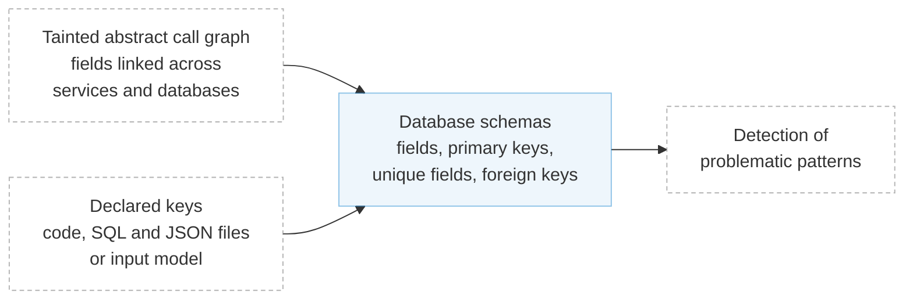

# Schema Extraction

## Overview

The schema extraction is the third step of Aletheia. The [intra-procedural](intra-procedural-analysis.md) and [inter-microservice](inter-microservice-analysis.md) analyses found how values are exchanged between services and which database operations each value is used in. From this, this step builds the schema of every database of the application, with its tables or collections, their fields, and the constraints on them. These are the integrity constraints that the [problematic patterns](../patterns.md) can break, namely foreign keys for referential integrity (RI-1, RI-2 and RI-3), primary keys for entity integrity (EI-1), and unique fields for uniqueness (Un-1).

In a monolithic application, these constraints are declared in a single database schema, and the database enforces them. Once the application is split into microservices, each service keeps its part of the data in its own database. Primary keys and unique fields can still be declared in each database, so Aletheia reads them from where they are declared. Foreign keys between the databases of different services, however, can no longer be declared, so the references between them exist only in the application code. Aletheia infers them from the fields that the [inter-microservice analysis](inter-microservice-analysis.md#tainting-the-abstract-call-graph) linked across databases.



### Tables and Fields

Aletheia describes every database with the terms of relational databases, but they apply to other kinds of databases too. A table can be a collection of a document store, a namespace of a cache or a topic of a queue, and a column can be a document field or an attribute. Each database has one **schema** per table, named `<database>.<schema>` (e.g., `posts_db.post`). Its **fields** are named after their object path, so nested fields and the elements of lists get their own fields (e.g., `posts_db.post.Creator.Username` and `posts_db.post.Mentions[*]`).

Aletheia collects the fields from the database taints of the arguments of each database call. For example, `StorageService.StorePost` writes a whole `Post` with `InsertOne`, so all the fields of `Post` are added to `posts_db.post`. Fields that no database call writes or reads do not appear in the schema. In postnotification, this gives:

| Schema | Fields |
| ------ | ------ |
| `posts_db.post` | `PostID`, `ReqID`, `Text`, `Mentions[*]`, `Creator.Username`, `Timestamp` |
| `notif_queue.notification` | `PostID`, `ReqID` |

### Primary Keys and Unique Fields

Primary keys and unique fields are declared in each database, and cannot be inferred from how the data flows. For an application written in Blueprint, Aletheia reads them from the `bson:"_id"` tags of the documents that its code inserts, and from the SQL and JSON schema files registered for the application in `registry/apps.yaml`. For an application described by an [input model](../4-formats/writing-input-models.md), it reads them from the input model:

| Source | Primary keys | Unique fields |
| ------ | ------------ | ------------- |
| Documents that the code inserts with `InsertOne` (see [Conventions](../5-reference/conventions.md#schema-fields)) | Fields tagged `bson:"_id"` | |
| SQL files listed in `sql_tables` | `PRIMARY KEY` columns of each `CREATE TABLE` | `UNIQUE` columns |
| JSON schema files in the `database` folder under `nosql_path` | | Fields listed in `uniqueItems` |
| [Input model](../4-formats/writing-input-models.md#databases) | `primary_key` of each schema | `unique` of each schema |

See [Registering an Application in Blueprint](../3-usage/blueprint-application.md) for how to declare `sql_tables` and `nosql_path`.

For example, in dsb_mediamicroservices, `MovieIdService` stores movies with their ID tagged `bson:"_id"`, and `database/movie_id_db.json` declares their title as unique:

```txt
PRIMARY KEY (movie_id_db.movie._id)
UNIQUE (movie_id_db.movie.Title)
```

These keys lead to the [EI-1](../patterns.md#ei-1-entity-integrity-uncoordinated-replication) and [Un-1](../patterns.md#un-1-uniqueness-conflicting-writes) violations that Aletheia reports for dsb_mediamicroservices. A movie is split between `movie_id_db` and `movie_info_db` under the same ID, and two concurrent registrations of a movie with the same title can leave a movie in `movie_info_db` without its record in `movie_id_db`.

### Inferring Foreign Keys

A foreign key states that every value of a field in one table exists in a field of another table. To find foreign keys that are not declared anywhere, Aletheia looks for a value that is read from or written to one table and then written to a table of another database. The value was first associated with a record of the first table, so the record written to the second table depends on that record existing. In other words, the second table references the first.

During the [walk of each request](inter-microservice-analysis.md#tainting-the-abstract-call-graph) through the abstract call graph, this shows up as an abstract object that gets taints from operations on two different databases. Each taint names the field, the operation and when it happens, so Aletheia knows which two fields the value links. Fields of the same database are never linked.

The taints do not say, however, which of the two fields references the other. To decide the direction, Aletheia takes the two operations in the order they happen in the request, `op1` and then `op2`, on the fields `field1` and `field2`, and applies one of five rules based on the type of each operation.

A **write** is any operation that changes data, such as an insert or an update. A **read** is either a **read key**, when the value is used to find records (e.g., a filter value or a cache key), or a **read value**, when the value is part of what the read returns. Deletes do not create foreign keys.

For example, in dsb_hotel, `ProfileService.GetProfiles` looks up the profile of each hotel in a cache. When the profile is not in the cache, it reads it from a NoSQL database and adds it to the cache:

```go title="blueprint/examples/dsb_hotel/workflow/hotelreservation/ProfileService.go" hl_lines="1 3"
exists, err := p.profileCache.Get(ctx, hid, &profile) // ← hid: read key, profile: read value
...
err = p.profileCache.Put(ctx, hid, profile)           // ← hid and profile: writes
```

The type belongs to each use of a value, not to the value itself. Here, `hid` is a read key in `Get` and a write in `Put`, and `profile` is a read value in `Get` and a write in `Put`. Other databases work the same way. In a NoSQL database, the document of `InsertOne` is a write, the values in the filter of `FindOne` are read keys, and the document that `One` reads is a read value. In a relational database, the values of an `INSERT` are writes, the arguments of the `WHERE` clause of `Select` or `Get` are read keys, and their destination is a read value. In a queue, the message of `Push` is a write, and the message of `Pop` is a read value.

| Rule | `op1` | `op2` | Foreign key | Why |
| ---- | ----- | ----- | ----------- | --- |
| 1 | read | write | `field2` references `field1` | The write stores a reference to the record that was read |
| 2 | write | read key | `field1` references `field2` | The write stored a reference to the record that is read |
| 3 | write | write | `field2` references `field1` | The request writes both records, and the second references the first, which it has just created |
| 4 | read value | read key | `field1` references `field2` | The value returned by the first read is then used as a key to look up the second record |
| 5 | read key | read key | `field2` references `field1` | The first read finds the referenced record by its key, and the second finds the record that holds that key |

Rule ④ is disabled by default. To enable it, set `CreateReferencesFromReadReadPairAndValKey` in [`internal/config/config.go`](https://github.com/aletheia-microservices/aletheia/blob/main/internal/config/config.go).

For example, in eshopmicroservices, `WebApp.OnPostAddToCartAsync` reads a product from `catalog_db` by its ID and then stores the product's ID, name and price in a basket in `basket_db`. By rule ①, the basket items reference the product:

```txt
FOREIGN_KEY basket_db.basket.Items[*].ProductId REFERENCES catalog_db.product.Id
FOREIGN_KEY basket_db.basket.Items[*].ProductName REFERENCES catalog_db.product.Name
FOREIGN_KEY basket_db.basket.Items[*].Price REFERENCES catalog_db.product.Price
```

Aletheia also tags some foreign keys in its output:

- A foreign key is **mandatory** (`[MANDATORY]`) when every request that stores the reference also writes the record it points to, as in rule ③. This is the setting of [RI-3](../patterns.md#ri-3-referential-integrity-uncoordinated-replication), where the record and the reference are written in the same request, but in different databases, so other requests may see one without the other.
- A foreign key is **transitive** (`[T]`) when Aletheia redirects it to the original record. When a new foreign key points to a field that already references a third field, Aletheia makes it point to that third field instead.

### Example: postnotification

The [inter-microservice analysis](inter-microservice-analysis.md#tainting-the-abstract-call-graph) left the post ID returned by `StorageService.StorePost` (`ao2`) with taints from two databases:

```txt
[write] [t3] @ posts_db.post.PostID
[write] [t13] @ notif_queue.notification.PostID
```

1. The two taints are on different databases, so the post ID links `posts_db.post.PostID` and `notif_queue.notification.PostID`.
2. In the order of the request, `op1` is the write of the post to `posts_db` during the call to `StorePost`, at `t3`, and `op2` is the push of the notification to the queue, at `t13`.
3. Both operations are writes, so by rule ③, the later field references the earlier one. This means that the notification references the post that the same request has just created.
4. Every request that pushes the notification also writes the post, so the foreign key is mandatory.

The request ID gets a foreign key the same way. `StorePost` writes it to `posts_db.post.ReqID` during the call, and `UploadPost` pushes it to the queue after the call. Aletheia saves the schemas of each database in `output/{app}/schema.json` and their constraints, one per line, in `output/{app}/constraints.txt`:

```txt title="output/postnotification/constraints.txt"
FOREIGN_KEY notif_queue.notification.PostID REFERENCES posts_db.post.PostID [MANDATORY]
FOREIGN_KEY notif_queue.notification.ReqID REFERENCES posts_db.post.ReqID [MANDATORY]
```

The [schema diagram](../3-usage/diagrams.md#schema-diagram) script draws `schema.json` as an image:


### Limitations

Aletheia infers foreign keys from how values flow through the code of each request, so it can infer foreign keys that do not exist, and miss some that do:

- **Over-approximation in taint tracking.** A value computed from several tainted values (e.g., `x ← a + b`) gets all their taints, which can link fields that do not reference each other.
- **Cross-request implicit associations.** When the client takes a value returned by one request and passes it to another, such as a station name in trainticket that is read in one request and used to create an order in another, the code never connects the two, and the foreign key is not inferred.
- **Parameterized dynamic queries.** Filters built at run time, such as the tag filters that sockshop adds from user input, are not analyzed.
- **Lookups by filter.** When an application finds related records by filtering on a value instead of looking them up by a foreign key, such as trainticket finding price configurations by train type name, the foreign key is not inferred.

To stop Aletheia from inferring a foreign key, list its referencing field in `ignore_foreignkeys` (see [Suppressing Detection Warnings](../3-usage/suppressing-warnings.md)).

The next step, the [detection of problematic patterns](detection-of-problematic-patterns.md), searches for operations that can violate these constraints. In postnotification, the mandatory foreign key on the post ID leads to the [RI-3](../patterns.md#ri-3-referential-integrity-uncoordinated-replication) violation.
