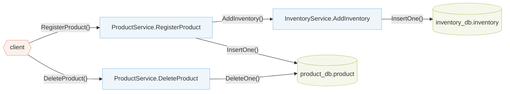

# Tutorial: Analyzing Your First Application (simpleshop)

We now demonstrate how to run Aletheia to analyze a simple application (`simpleshop`) provided in `blueprint/examples/simpleshop/`. The application is composed of two microservices, Product Service and Inventory Service, and allows clients to register new products and their respective inventory, as well as delete products.

Below is a high-level representation of simpleshop. It shows the services and databases of the application and the calls between them. Each path from the client follows one client request through the services and databases it can reach:



Add a new entry for the `simpleshop` application at the end of the `apps` list in `registry/apps.yaml`. This will tell Aletheia how to properly import and analyze the application:

```yaml title="registry/apps.yaml" hl_lines="4-8"
apps:
  # ... existing entries ...

  - name: simpleshop
    app_root: github.com/blueprint-uservices/blueprint/examples/simpleshop
    package_path: simpleshop/workflow/simpleshop
    spec_name: simpleshop_docker
    spec_path: github.com/blueprint-uservices/blueprint/examples/simpleshop/wiring/specs
```

Now, you will need to generate the application registry according to the new entry added to `registry/apps.yaml`. The following command will (i) generate a Go file under `internal/frameworks/blueprint/apps/` defining how Aletheia locates applications and imports their corresponding Blueprint specs, (ii) update `go.mod` with new entries so that Go can locate applications relative to Aletheia's path, and (iii) rebuild `bin/aletheia` so that it includes the new application.

```zsh
make registry
```

Now, you can run the analysis:

```zsh
./bin/aletheia simpleshop
```

This command prints the analysis results and saves them in `output/simpleshop/`.

The output should contain a referential integrity warning indicating a missing cascading delete (pattern RI-1, see [Reading Detection Warnings](../4-formats/reading-warnings.md)). In this case, when a product is deleted, the effect is not propagated to the Inventory Service, leaving a dangling inventory record.

```txt
[NUM_WARNINGS = 1]
delete: ProductService.DeleteProduct() ... product_db.product.DeleteOne()
	missing cascade #1: database={inventory_db}, entity={inventory}, pending_fields={ID}
```

If you want to suppress all warnings related to missing cascade deletes on the inventory, create a new YAML file at `config/simpleshop.yaml` with the following content:

```yaml title="config/simpleshop.yaml"
app: simpleshop
ignore_cascade:
  - database: inventory_db
    entity: inventory
    # optional fields for more fine-grained control
    trigger_database: product_db
    trigger_entity: product
```

Then, you can run the analysis again and pass the `--detection_config` flag followed by the file path:

```zsh
./bin/aletheia --detection_config config/simpleshop.yaml simpleshop
```

> [!WARNING]
> The tutorial modifies files tracked by git. When you are done, you can undo these changes with:
>
> ```zsh
> git restore registry/apps.yaml go.mod internal/frameworks/blueprint/apps/apps.go
> make build
> rm config/simpleshop.yaml
> ```
