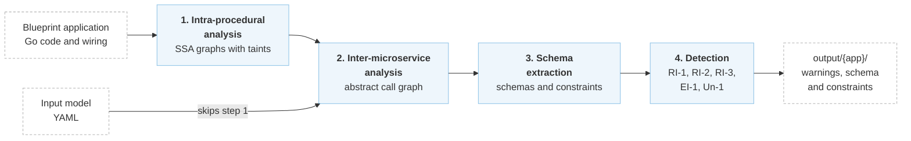

# Aletheia

[](https://github.com/aletheia-microservices/aletheia/blob/main/LICENSE)
[](https://aletheia-microservices.github.io/aletheia/)
[](https://github.com/aletheia-microservices/aletheia/blob/main/go.mod)
[](https://www.usenix.org/conference/osdi26/presentation/ferreira)
[](https://www.usenix.org/system/files/osdi26-ferreira.pdf)
[](#citation)

**Aletheia: Automated Detection of Data Integrity Violations in Microservices**<br>
Mafalda Sofia Ferreira, João Ferreira Loff, João Garcia, and Rodrigo Rodrigues<br>
INESC-ID, Instituto Superior Técnico, Universidade de Lisboa<br>
*20th USENIX Symposium on Operating Systems Design and Implementation (OSDI ’26)*

For instructions on how to reproduce the experiments from the paper, see the [Aletheia Artifact OSDI'26](https://github.com/aletheia-microservices/aletheia-artifact-osdi26) repository.

## Overview

In microservice architectures, data is stored across heterogeneous systems, with data schemas partitioned and managed by separate services. Due to the complexity of microservices, it can be almost impossible for developers to have a comprehensive understanding of the entire system, making it challenging to reason about and maintain data integrity at the application level.

Aletheia solves this problem through static analysis by identifying semantic violations (see [What Aletheia Detects](patterns.md)) in microservice ecosystems (i.e., service interactions and operations that break data integrity) for various types of integrity constraints:

- Entity integrity (defined through primary keys)
- Referential integrity (defined through foreign keys)
- Uniqueness

Aletheia analyzes applications targeting the [Blueprint](https://github.com/Blueprint-uServices/blueprint) compiler.

The code of all applications is located in `blueprint/examples/`, which includes a [README](https://github.com/aletheia-microservices/blueprint/blob/osdi26/examples/README.md) summarizing the source repositories and versions used for each application.

The framework operates in four steps:

1. [Intra-procedural analysis](1-pipeline/intra-procedural-analysis.md) based on Static Single-Assignment (SSA) graphs extracted from Go code to infer how values flow throughout execution by propagating taint information
2. [Inter-microservice analysis](1-pipeline/inter-microservice-analysis.md) based on a new _abstract call graph_ that represents possible call graphs containing microservice invocations and database operations, along with filtered taint information from the SSA analysis
3. [Schema extraction](1-pipeline/schema-extraction.md) for objects stored across databases
4. [Detection of problematic patterns](1-pipeline/detection-of-problematic-patterns.md) in the code that can lead to violations of entity integrity, referential integrity, and uniqueness constraints



The detection step searches for five patterns of operations that break these constraints, described in [What Aletheia Detects](patterns.md). To build Aletheia and analyze your first application, see [Installation](2-getting-started/installation.md).

## Citation

If you use Aletheia in your work, please cite our paper:

```bibtex
@inproceedings{aletheia-osdi26,
  author = {Mafalda Sofia Ferreira and Jo{\~a}o Ferreira Loff and Jo{\~a}o Garcia and Rodrigo Rodrigues},
  title = {Aletheia: Automated Detection of Data Integrity Violations in Microservices},
  booktitle = {20th USENIX Symposium on Operating Systems Design and Implementation (OSDI 26)},
  year = {2026},
  isbn = {978-1-939133-55-7},
  address = {Seattle, WA},
  pages = {721--737},
  url = {https://www.usenix.org/conference/osdi26/presentation/ferreira},
  publisher = {USENIX Association},
  month = jul
}
```
