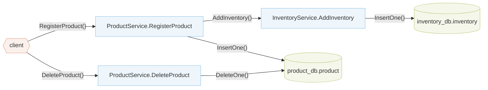

# Tutorial: Analyzing Your First Application (simpleshop)

This tutorial uses `simpleshop`, a small application in `blueprint/examples/simpleshop/` with two microservices: Product Service and Inventory Service. Clients can register products with their inventory and delete products. We will register the application in Aletheia, analyze it, and inspect a warning about inventory records left behind after a product is deleted.

Registering a product writes to both databases. Deleting it only changes `product_db`:



Add a new entry for the `simpleshop` application at the end of the `apps` list in `registry/apps.yaml`. This tells Aletheia where to find the code and Blueprint wiring spec:

```yaml title="registry/apps.yaml" hl_lines="4-8"
apps:
  # ... existing entries ...

  - name: simpleshop
    app_root: github.com/blueprint-uservices/blueprint/examples/simpleshop
    package_path: simpleshop/workflow/simpleshop
    spec_name: simpleshop_docker
    spec_path: github.com/blueprint-uservices/blueprint/examples/simpleshop/wiring/specs
```

Regenerate the registry to include the new entry. This generates the Blueprint spec imports in `internal/frameworks/blueprint/apps/`, updates the local application paths in `go.mod`, and rebuilds `bin/aletheia`:

```zsh
make registry
```

Run the analysis:

```zsh
./bin/aletheia simpleshop
```

This command prints the analysis results and saves them in `output/simpleshop/`.

The output should contain one warning for a missing cascading delete (RI-1). `DeleteProduct` removes the product but leaves its inventory record, which still references the deleted product (see [Reading Detection Warnings](../4-formats/reading-warnings.md)):

```txt
[NUM_WARNINGS = 1]
delete: ProductService.DeleteProduct() ... product_db.product.DeleteOne()
	missing cascade #1: database={inventory_db}, entity={inventory}, pending_fields={ID}
```

If you want to suppress all warnings related to missing cascade deletes on the inventory, create a new YAML file at `config/simpleshop.yaml` with the following content:

```yaml title="config/simpleshop.yaml"
app: simpleshop
ignore_cascade:
  - database: inventory_db
    entity: inventory
    # optional fields for more fine-grained control
    trigger_database: product_db
    trigger_entity: product
```

Run the analysis again with this config:

```zsh
./bin/aletheia --detection_config config/simpleshop.yaml simpleshop
```

> [!WARNING]
> The tutorial modifies files tracked by git. When you are done, you can undo these changes with:
>
> ```zsh
> git restore registry/apps.yaml go.mod internal/frameworks/blueprint/apps/apps.go
> make build
> rm config/simpleshop.yaml
> ```
