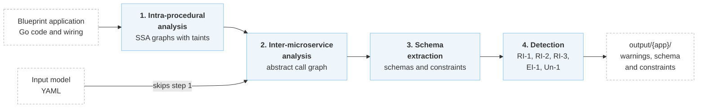

# Aletheia

<div class="publication-card" markdown>

<p class="publication-card__title">Aletheia: Automated Detection of Data Integrity Violations in Microservices</p>
<p class="publication-card__authors">Mafalda Sofia Ferreira, João Ferreira Loff, João Garcia, Rodrigo Rodrigues</p>
<p class="publication-card__affiliation">INESC-ID, Instituto Superior Técnico, Universidade de Lisboa</p>
<p class="publication-card__venue">20th USENIX Symposium on Operating Systems Design and Implementation (OSDI 2026)</p>

</div>

For instructions on how to reproduce the experiments from the paper, see the [Aletheia Artifact OSDI'26](https://github.com/aletheia-microservices/aletheia-artifact-osdi26) repository. For the latest updates and ongoing development, refer to the main [Aletheia](https://github.com/aletheia-microservices/aletheia) repository, which is actively maintained.

## Overview

Microservices store data in separate databases, often using different storage systems. Relationships between that data still need to hold across services, but individual databases cannot enforce them. Keeping these relationships consistent becomes harder as the application grows.

Aletheia uses static analysis to find service interactions and database operations that can break these relationships (see [What Aletheia Detects](patterns.md)). It checks three types of integrity constraints:

- Entity integrity (defined through primary keys)
- Referential integrity (defined through foreign keys)
- Uniqueness

Aletheia analyzes applications targeting the [Blueprint](https://github.com/Blueprint-uServices/blueprint) compiler.

The code of all applications is located in `blueprint/examples/`, which includes a [README](https://github.com/aletheia-microservices/blueprint/blob/osdi26/examples/README.md) summarizing the source repositories and versions used for each application.

The analysis has four steps:

1. [Intra-procedural analysis](1-pipeline/intra-procedural-analysis.md) tracks values within each function using Static Single-Assignment (SSA) graphs and taint propagation.
2. [Inter-microservice analysis](1-pipeline/inter-microservice-analysis.md) connects these values across services through an _abstract call graph_ of service calls and database operations.
3. [Schema extraction](1-pipeline/schema-extraction.md) builds the database schemas and infers relationships between fields stored in different databases.
4. [Detection of problematic patterns](1-pipeline/detection-of-problematic-patterns.md) checks the operations against patterns that can violate the extracted constraints.



The detection step searches for five patterns of operations that break these constraints, described in [What Aletheia Detects](patterns.md). To build Aletheia and analyze your first application, see [Installation](2-getting-started/installation.md).

## Citation

If you use Aletheia in your work, please cite our paper:

```bibtex
@inproceedings{aletheia-osdi26,
  author = {Mafalda Sofia Ferreira and Jo{\~a}o Ferreira Loff and Jo{\~a}o Garcia and Rodrigo Rodrigues},
  title = {Aletheia: Automated Detection of Data Integrity Violations in Microservices},
  booktitle = {20th USENIX Symposium on Operating Systems Design and Implementation (OSDI 2026)},
  year = {2026},
  isbn = {978-1-939133-55-7},
  address = {Seattle, WA},
  pages = {721--737},
  url = {https://www.usenix.org/conference/osdi26/presentation/ferreira},
  publisher = {USENIX Association},
  month = jul
}
```
