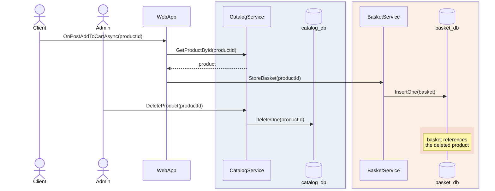
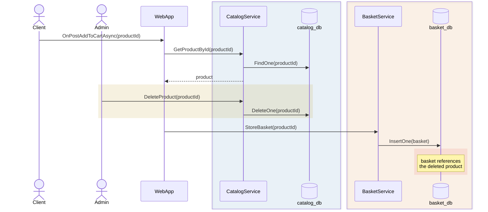
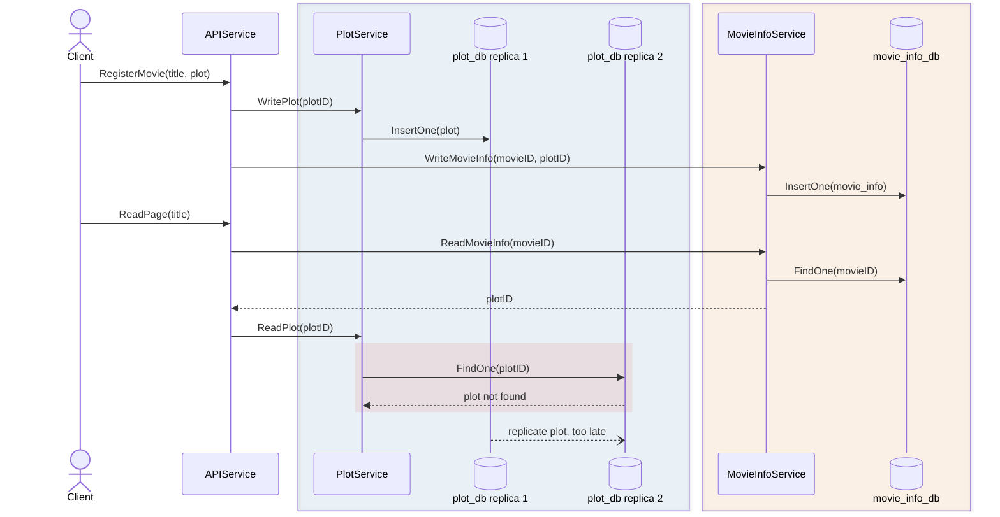
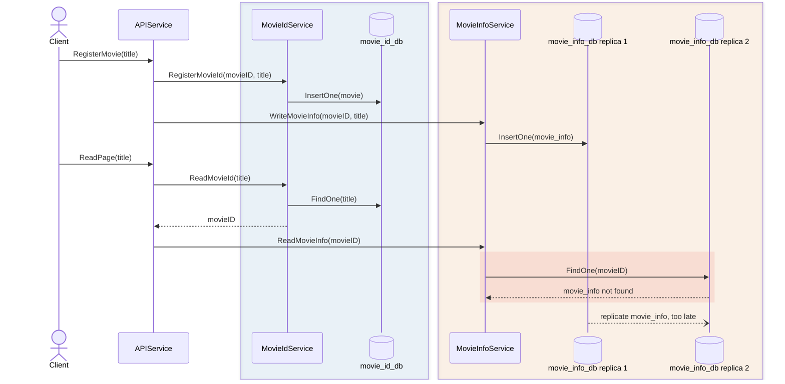
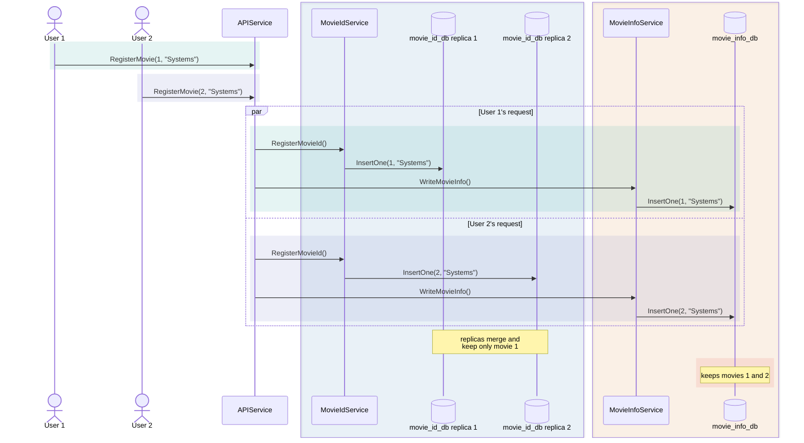

# What Aletheia Detects

In microservice applications, data is partitioned across several databases, each managed by a separate service. The logical relationships between that data remain the same as in a monolithic application, but database-level enforcement mechanisms, such as foreign keys, no longer apply across service boundaries. As a result, data integrity constraints must be preserved by the application code, where they can easily be overlooked. Thus, Aletheia identifies the operations and service interactions that may violate these integrity constraints.

For a motivating example of how this happens when an application is split into services, see [Section 2 of the paper](https://www.usenix.org/system/files/osdi26-ferreira.pdf).

## Integrity Constraints

Aletheia checks three types of integrity constraints in microservices. In brief:

- Referential integrity (RI): a record can only be referenced if it exists.
- Entity integrity (EI): a primary key uniquely identifies an entity (including all its partitioned sub-entities).
- Uniqueness (Un): a unique value is never repeated.

## Patterns

Aletheia searches for five patterns of operations that can violate these constraints:

| Constraint | Pattern | Simple Example |
| ---------- | ------- | ------- |
| Referential integrity | Absence of cascading deletes ([RI-1](#ri-1-referential-integrity-absence-of-cascading-deletes)) | Deleting a product leaves it in users' baskets |
| Referential integrity | Concurrent operations ([RI-2](#ri-2-referential-integrity-concurrent-operations)) | A product is deleted while someone adds it to their basket |
| Referential integrity | Uncoordinated replication ([RI-3](#ri-3-referential-integrity-uncoordinated-replication)) | A movie's details point to a plot that is not visible yet |
| Entity integrity | Uncoordinated replication ([EI-1](#ei-1-entity-integrity-uncoordinated-replication)) | A movie's title is visible, but its details are not yet |
| Uniqueness | Conflicting writes ([Un-1](#un-1-uniqueness-conflicting-writes)) | Two movies titled "Systems" in one database, one in the other |

The examples below come from two real applications (see [Getting Started → Example Applications](getting-started/example-applications.md)). RI-1 and RI-2 use an online shop (`eshopmicroservices`), and RI-3, EI-1, and Un-1 use a movie review application (`dsb_mediamicroservices`). Each pattern below has an interactive diagram of how the violation happens (use the buttons under it, or click a step), and the code behind it (collapsed). The formal definitions are in [Section 3 of the paper](https://www.usenix.org/system/files/osdi26-ferreira.pdf).

## RI-1: Referential integrity, absence of cascading deletes

A request deletes a record but not the records in other databases that reference it, so those records point to something that no longer exists. This pattern occurs regardless of concurrency scenarios or replication configurations.

**Example:** `eshopmicroservices` is an online shop with catalog, basket, discount and order services, where deleting a product leaves it in the users' baskets.

<div class="diagram-steps" markdown>



1. A client adds a product to their basket. `WebApp.OnPostAddToCartAsync()` reads the product through `CatalogService` and stores its ID, name, and price in the basket in `basket_db`.
2. Later, an admin deletes the product through `CatalogService.DeleteProduct()`, which removes it from `catalog_db` but does not call `BasketService` to remove it from the baskets.
3. The basket in `basket_db` still references a product that no longer exists.

</div>

_Problem:_ `basket_db` keeps baskets with a product that no longer exists in `catalog_db`, so requests that process these baskets may fail.
{ .impact }

<details markdown>
<summary>Code: <code>CatalogService.DeleteProduct()</code></summary>

```go title="blueprint/examples/eshopmicroservices/workflow/catalog/catalog_service.go" linenums="47" hl_lines="2"
--8<-- "blueprint/examples/eshopmicroservices/workflow/catalog/catalog_service.go:47:49"
```

```go title="blueprint/examples/eshopmicroservices/workflow/catalog/catalog_service.go" linenums="83" hl_lines="7"
--8<-- "blueprint/examples/eshopmicroservices/workflow/catalog/catalog_service.go:83:90"
```

</details>

## RI-2: Referential integrity, concurrent operations

A request reads a record and stores a reference to it in another database. Meanwhile, a concurrent request deletes that record. Each request is correct on its own, but the final application state becomes inconsistent when those requests execute concurrently.

**Example:** In the same online shop, an admin may delete a product while a user adds it to their basket.

Note that the application does not cascade the deletion of a product to the baskets, which leads to [RI-1](#ri-1-referential-integrity-absence-of-cascading-deletes). But even if it did, RI-2 would still occur, since the cascade runs during the delete, before the basket with the product is stored.

<div class="diagram-steps" markdown>



1. A client adds a product to their basket. `WebApp.OnPostAddToCartAsync()` reads the product from `catalog_db` through `CatalogService`.
2. Before `WebApp` stores the basket, an admin deletes the same product from `catalog_db` (highlighted).
3. `WebApp` stores the basket with the product's ID in `basket_db`.
4. The basket now references a product that no longer exists.

</div>

_Problem:_ `basket_db` keeps a basket that references a product that no longer exists in `catalog_db`, so requests that process the basket may fail.
{ .impact }

<details markdown>
<summary>Code: <code>WebApp.OnPostAddToCartAsync()</code> and <code>CatalogService.DeleteProduct()</code></summary>

```go title="blueprint/examples/eshopmicroservices/workflow/web/webapp.go" linenums="134" hl_lines="2 13 20"
--8<-- "blueprint/examples/eshopmicroservices/workflow/web/webapp.go:134:159"
```

```go title="blueprint/examples/eshopmicroservices/workflow/catalog/catalog_service.go" linenums="83" hl_lines="7"
--8<-- "blueprint/examples/eshopmicroservices/workflow/catalog/catalog_service.go:83:90"
```

</details>

## RI-3: Referential integrity, uncoordinated replication

A request writes a record to one database and then a reference to it in another. Since each database employs its own replication mechanisms, another service can obtain the reference and then search for the record on a replica where the record is not visible yet.

**Example:** `dsb_mediamicroservices` is a movie review application from the DeathStarBench benchmark, where a movie's details may refer to a plot that is not visible yet.

<div class="diagram-steps" markdown>



1. `RegisterMovie()` stores the plot on replica 1 of `plot_db`, through `PlotService`, and then the movie's details, which reference the plot by its `PlotID`, in `movie_info_db`.
2. `ReadPage()` reads the movie's details from `movie_info_db`, through `PageService`, which give it the `PlotID`.
3. It then reads the plot by that `PlotID` from replica 2 of `plot_db`, which does not have it yet.
4. The plot is replicated to replica 2 only afterwards.

</div>

_Problem:_ `movie_info_db` may reference a plot that is not yet visible in `plot_db`, so reading the movie page may fail.
{ .impact }

<details markdown>
<summary>Code: <code>APIService.RegisterMovie()</code> and <code>PageService.ReadPage()</code></summary>

```go title="blueprint/examples/dsb_mediamicroservices/workflow/mediamicroservices/APIService.go" linenums="73" hl_lines="18 28"
--8<-- "blueprint/examples/dsb_mediamicroservices/workflow/mediamicroservices/APIService.go:73:107"
```

```go title="blueprint/examples/dsb_mediamicroservices/workflow/mediamicroservices/PageService.go" linenums="22" hl_lines="2 22"
--8<-- "blueprint/examples/dsb_mediamicroservices/workflow/mediamicroservices/PageService.go:22:49"
```

</details>

## EI-1: Entity integrity, uncoordinated replication

A request stores different parts of an entity in two databases using the same primary key. Another request reads both parts using that key, but since the databases replicate independently, one part may be available before the other.

Unlike RI-3, neither record references the other. Instead, they represent two parts of the same entity that share a primary key.

**Example:** In the same movie review site, each movie is split between `movie_id_db` and `movie_info_db`, so a movie may be found while its details are not visible yet.

<div class="diagram-steps" markdown>



1. `RegisterMovie()` stores the movie's ID and title in `movie_id_db` and its details in replica 1 of `movie_info_db`, both using the same `MovieID`.
2. `ReadPage()` finds the movie by its title in `movie_id_db` and retrieves its `MovieID`.
3. It then reads the movie's details using that `MovieID` through `PageService`, but replica 2 of `movie_info_db` does not have them yet.
4. The details are only replicated to replica 2 afterwards.

</div>

_Problem:_ `movie_id_db` and `movie_info_db` are not guaranteed to be visible at the same time, so reading the movie page may fail.
{ .impact }

<details markdown>
<summary>Code: <code>APIService.RegisterMovie()</code> and <code>APIService.ReadPage()</code></summary>

```go title="blueprint/examples/dsb_mediamicroservices/workflow/mediamicroservices/APIService.go" linenums="73" hl_lines="23 28 38 43"
--8<-- "blueprint/examples/dsb_mediamicroservices/workflow/mediamicroservices/APIService.go:73:121"
```

</details>

## Un-1: Uniqueness, conflicting writes

A request stores a unique value in one database and related data in another. Some replicated databases allow writes on multiple replicas and enforce uniqueness based only on the data available in each replica. If two concurrent requests write the same value to different replicas, both may succeed. When the replicas synchronize, the database detects the duplicate and keeps only one of the writes. However, the related data from the discarded write remains in the other database.

**Example:** In the same movie review site, movie titles are unique, but two users may register movies with the same title at the same time.

<div class="diagram-steps" markdown>



1. Two users register different movies with the same title, "Systems", at the same time.
2. Each request stores the title in a different replica of `movie_id_db`, which accepts the write because it has not seen the other one. Both requests also store their movie's details in `movie_info_db`.
3. When the replicas of `movie_id_db` synchronize, they detect the duplicate title and keep only MovieID 1.
4. `movie_info_db` still contains the details of both movies, including MovieID 2, which no longer exists in `movie_id_db`.

</div>

_Problem:_ `movie_info_db` keeps an orphaned record for MovieID 2, so later reads of the movie page may observe partial results across `movie_id_db` and `movie_info_db`.
{ .impact }

<details markdown>
<summary>Code: <code>APIService.RegisterMovie()</code> (uniqueness constraint on title)</summary>

```go title="blueprint/examples/dsb_mediamicroservices/workflow/mediamicroservices/APIService.go" linenums="95" hl_lines="1 6"
--8<-- "blueprint/examples/dsb_mediamicroservices/workflow/mediamicroservices/APIService.go:95:104"
```

</details>
