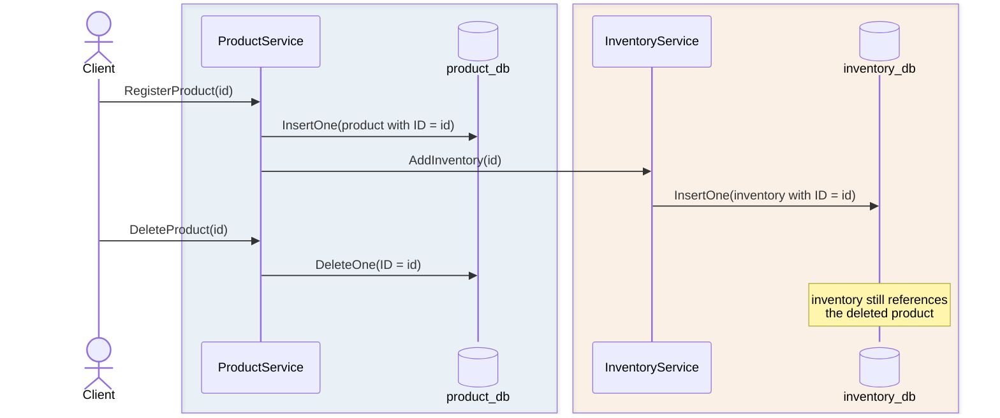
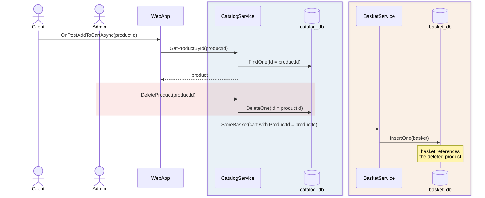
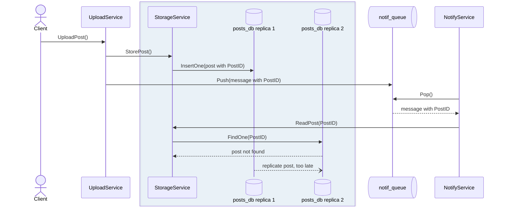
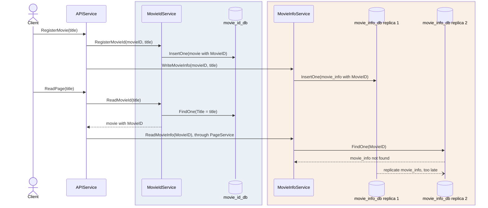
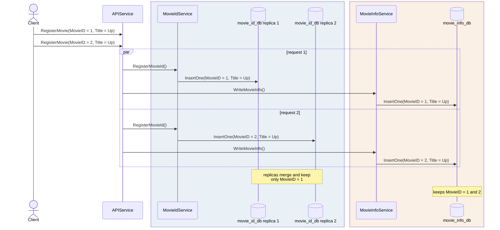

# What Aletheia Detects

In microservice applications, data is partitioned across several databases, each managed by a separate service. The logical relationships between that data remain the same as in a monolithic application, but database-level enforcement mechanisms, such as foreign keys, no longer apply across service boundaries. As a result, data integrity constraints must be preserved by the application code, where they can easily be overlooked. Aletheia identifies the operations and service interactions that may violate them.

For example, consider the online course enrollment application in the paper (Section 2.2). In a monolithic version, a single database holds the `course`, `course details` and `enrollment` tables and enforces the foreign keys between them. After the application is decomposed into three services, each table belongs to a different database, and these foreign keys (crossed out in red) can no longer be declared:

```mermaid
flowchart LR
    enrollment["<b>Enrollment Service</b><table style='margin:8px auto 0;border-collapse:collapse;background:var(--md-default-bg-color);border:1px solid #8888'><tr><th colspan='2' style='padding:3px 10px;border-bottom:1px solid #8888'>enrollment</th></tr><tr><td style='padding:2px 10px;text-align:left'>course_id</td><td style='padding:2px 10px;text-align:left'>PK, <s style='color:#dc322f'>FK</s></td></tr><tr><td style='padding:2px 10px;text-align:left'>...</td><td style='padding:2px 10px;text-align:left'></td></tr></table>"]
    course["<b>Course Service</b><table style='margin:8px auto 0;border-collapse:collapse;background:var(--md-default-bg-color);border:1px solid #8888'><tr><th colspan='2' style='padding:3px 10px;border-bottom:1px solid #8888'>course</th></tr><tr><td style='padding:2px 10px;text-align:left'>course_id</td><td style='padding:2px 10px;text-align:left'>PK</td></tr><tr><td style='padding:2px 10px;text-align:left'>name</td><td style='padding:2px 10px;text-align:left'>UNIQUE</td></tr></table>"]
    details["<b>Course Details Service</b><table style='margin:8px auto 0;border-collapse:collapse;background:var(--md-default-bg-color);border:1px solid #8888'><tr><th colspan='2' style='padding:3px 10px;border-bottom:1px solid #8888'>course details</th></tr><tr><td style='padding:2px 10px;text-align:left'>course_id</td><td style='padding:2px 10px;text-align:left'>PK, <s style='color:#dc322f'>FK</s></td></tr><tr><td style='padding:2px 10px;text-align:left'>...</td><td style='padding:2px 10px;text-align:left'></td></tr></table>"]
    enrollment -. "<span style='color:#dc322f'>✕ course_id</span>" .- course
    course -. "<span style='color:#dc322f'>✕ course_id</span>" .- details
    %% the foreign keys that the decomposition removes are red
    linkStyle 0,1 stroke:#dc322f,stroke-width:2px
    classDef enrollment fill:#85990014,stroke:#85990080
    classDef course fill:#268bd214,stroke:#268bd280
    classDef details fill:#f57c0014,stroke:#f57c0080
    class enrollment enrollment
    class course course
    class details details
```



## Integrity Constraints

Aletheia checks three types of integrity constraints. The ID of each pattern starts with the constraint it violates:

- **Referential integrity (RI):** a record can only be referenced if it exists.
- **Entity integrity (EI):** a primary key identifies all the parts of a partitioned entity.
- **Uniqueness (Un):** a unique value is never repeated.

## Patterns

Aletheia searches for five patterns of operations that can violate these constraints:

| Pattern | Constraint | Example |
| ------- | ----------- | ------- |
| [**RI-1**](#ri-1-referential-integrity-absence-of-cascading-deletes) absence of cascading deletes | Referential integrity | Deleting a product leaves its inventory behind |
| [**RI-2**](#ri-2-referential-integrity-concurrent-operations) concurrent operations | Referential integrity | A product is deleted while someone adds it to their basket |
| [**RI-3**](#ri-3-referential-integrity-uncoordinated-replication) uncoordinated replication | Referential integrity | A notification arrives before the post it announces |
| [**EI-1**](#ei-1-entity-integrity-uncoordinated-replication) uncoordinated replication | Entity integrity | A movie's title is visible, but its details are not yet |
| [**Un-1**](#un-1-uniqueness-conflicting-writes) conflicting writes | Uniqueness | Two movies titled "Up" in one database, one in the other |

Each pattern below has an example from a real application, an interactive diagram of how the violation happens (use the buttons under it, or click a step), and the code behind it (collapsed). The formal definitions are in the paper (Section 3).

## RI-1: Referential integrity, absence of cascading deletes

A request deletes a record but not the records in other databases that reference it, so those records point to something that no longer exists. This pattern needs no concurrency or replication: it happens every time the delete runs.

_Example:_ `simpleshop` is a small store with a product service and an inventory service. `ProductService.DeleteProduct()` deletes a product from `product_db` but leaves its inventory in `inventory_db`.

<div class="diagram-steps" markdown>



1. `RegisterProduct()` stores the product in `product_db` and calls `InventoryService.AddInventory()`, which stores its inventory in `inventory_db` under the same ID. The inventory now references the product.
2. `DeleteProduct()` deletes the product from `product_db`, but never asks `InventoryService` to delete its inventory.
3. The inventory in `inventory_db` still references the deleted product.

</div>

<details markdown>
<summary>Code: <code>ProductService.RegisterProduct()</code> and <code>ProductService.DeleteProduct()</code></summary>

```go title="blueprint/examples/simpleshop/workflow/simpleshop/ProductService.go" linenums="30" hl_lines="12 17 29"
--8<-- "blueprint/examples/simpleshop/workflow/simpleshop/ProductService.go:30:59"
```

</details>

!!! danger "Impact"
    `inventory_db` keeps an inventory record for a product that no longer exists in `product_db`, so requests that read this record and then look up its product may fail.

## RI-2: Referential integrity, concurrent operations

A request reads a record and stores a reference to it in another database. Meanwhile, a concurrent request deletes that record. Each request is correct on its own: the problem appears only when they overlap.

_Example:_ `eshopmicroservices` is an online shop with catalog, basket, discount and order services. `WebApp.OnPostAddToCartAsync()` reads a product from `catalog_db` and then saves it in the user's basket in `basket_db`. If an admin deletes the product with `CatalogService.DeleteProduct()` in between (highlighted below), the basket keeps a product that no longer exists.

<div class="diagram-steps" markdown>



1. A client adds a product to their basket: `WebApp.OnPostAddToCartAsync()` reads the product from `catalog_db` through `CatalogService`.
2. Before `WebApp` stores the basket, an admin deletes the same product from `catalog_db` (highlighted).
3. `WebApp` stores the basket, with the product's ID, in `basket_db`.
4. The basket references a product that no longer exists.

</div>

<details markdown>
<summary>Code: <code>WebApp.OnPostAddToCartAsync()</code> and <code>CatalogService.DeleteProduct()</code></summary>

```go title="blueprint/examples/eshopmicroservices/workflow/web/webapp.go" linenums="134" hl_lines="2 13 20"
--8<-- "blueprint/examples/eshopmicroservices/workflow/web/webapp.go:134:159"
```

```go title="blueprint/examples/eshopmicroservices/workflow/catalog/catalog_service.go" linenums="83" hl_lines="7"
--8<-- "blueprint/examples/eshopmicroservices/workflow/catalog/catalog_service.go:83:90"
```

</details>

!!! danger "Impact"
    `basket_db` keeps a basket that references a product that no longer exists in `catalog_db`, so requests that process the basket may fail.

## RI-3: Referential integrity, uncoordinated replication

A request writes a record to one database and then a reference to it in another. Since each database replicates on its own, another service can get the reference and then look for the record on a replica that does not have it yet.

_Example:_ `postnotification` is an app that stores posts and sends a notification for each new one. `UploadService.UploadPost()` saves a post in `posts_db` and pushes a notification with its `PostID` to the queue `notif_queue`. `NotifyService` takes the notification and looks up the post on another replica of `posts_db`, which may not have it yet. A queue counts as a database here: it stores the notification, which holds the reference.

<div class="diagram-steps" markdown>



1. `UploadPost()` stores the post on replica 1 of `posts_db`, through `StorageService`, and pushes a notification with the post's ID to `notif_queue`.
2. `NotifyService` pops the notification and asks `StorageService` for the post.
3. `StorageService` reads replica 2 of `posts_db`, which does not have the post yet.
4. The post is replicated to replica 2 only afterwards.

</div>

<details markdown>
<summary>Code: <code>UploadService.UploadPost()</code> and <code>NotifyService.Run()</code></summary>

```go title="blueprint/examples/postnotification/workflow/postnotification/UploadService.go" linenums="24" hl_lines="3 9"
--8<-- "blueprint/examples/postnotification/workflow/postnotification/UploadService.go:24:37"
```

```go title="blueprint/examples/postnotification/workflow/postnotification/NotifyService.go" linenums="24" hl_lines="8 15"
--8<-- "blueprint/examples/postnotification/workflow/postnotification/NotifyService.go:24:42"
```

</details>

!!! danger "Impact"
    If replication is stale, users may receive notifications for posts that cannot be read yet.

## EI-1: Entity integrity, uncoordinated replication

A request stores one entity in two databases under the same primary key, part in each. Another request reads both parts by that key, and since each database replicates on its own, it can find one part but not yet the other.

Unlike RI-3, neither record references the other: they are two halves of one entity that share a key.

_Example:_ `dsb_mediamicroservices` is a movie review site from the DeathStarBench benchmark. `APIService.RegisterMovie()` saves each movie's ID and title in `movie_id_db` and its details in `movie_info_db`, both under the same `MovieID`. `APIService.ReadPage()` can find the movie in `movie_id_db` but not its details in `movie_info_db`.

<div class="diagram-steps" markdown>



1. `RegisterMovie()` stores the movie's ID and title in `movie_id_db`, and its details on replica 1 of `movie_info_db`, both under the same `MovieID`.
2. `ReadPage()` finds the movie by its title in `movie_id_db`, which gives it the `MovieID`.
3. It then reads the details by that `MovieID` from replica 2 of `movie_info_db`, which does not have them yet.
4. The details are replicated to replica 2 only afterwards.

</div>

<details markdown>
<summary>Code: <code>APIService.RegisterMovie()</code> and <code>APIService.ReadPage()</code></summary>

```go title="blueprint/examples/dsb_mediamicroservices/workflow/mediamicroservices/APIService.go" linenums="73" hl_lines="23 28 38 43"
--8<-- "blueprint/examples/dsb_mediamicroservices/workflow/mediamicroservices/APIService.go:73:121"
```

</details>

!!! danger "Impact"
    `movie_id_db` and `movie_info_db` are not guaranteed to be visible at the same time, so reading the movie page may fail.

## Un-1: Uniqueness, conflicting writes

A request writes a value that must be unique to one database and related data to another. Some replicated databases accept writes on every replica and check uniqueness only against the data that replica already has. If two concurrent requests write the same value on different replicas, both succeed. When the replicas later exchange their writes, the database finds the duplicate and keeps only one. The related data of the discarded write stays in the other database.

_Example:_ `dsb_mediamicroservices` is a movie review site from the DeathStarBench benchmark, where movie titles are unique in `movie_id_db`. Two concurrent `APIService.RegisterMovie()` calls for a movie titled "Up" both succeed. After the replicas of `movie_id_db` merge, it keeps one movie titled "Up", but `movie_info_db` keeps the details of both.

<div class="diagram-steps" markdown>



1. Two requests register two different movies with the same title, "Up", at the same time.
2. Each request writes the title to a different replica of `movie_id_db`, which accepts it, since it has not seen the other write. Both requests also store their movie's details in `movie_info_db`.
3. When the replicas of `movie_id_db` merge, they find two movies titled "Up" and keep only MovieID 1.
4. `movie_info_db` still keeps the details of both movies, including MovieID 2, which no longer exists in `movie_id_db`.

</div>

<details markdown>
<summary>Code: <code>APIService.RegisterMovie()</code> and the uniqueness constraint on <code>Title</code></summary>

```go title="blueprint/examples/dsb_mediamicroservices/workflow/mediamicroservices/APIService.go" linenums="95" hl_lines="1 6"
--8<-- "blueprint/examples/dsb_mediamicroservices/workflow/mediamicroservices/APIService.go:95:104"
```

```json title="blueprint/examples/dsb_mediamicroservices/workflow/mediamicroservices/database/movie_id_db.json" hl_lines="6-8"
--8<-- "blueprint/examples/dsb_mediamicroservices/workflow/mediamicroservices/database/movie_id_db.json"
```

</details>

!!! danger "Impact"
    `movie_info_db` keeps an orphaned record for MovieID 2, so later reads of the movie page may observe partial results across `movie_id_db` and `movie_info_db`.
