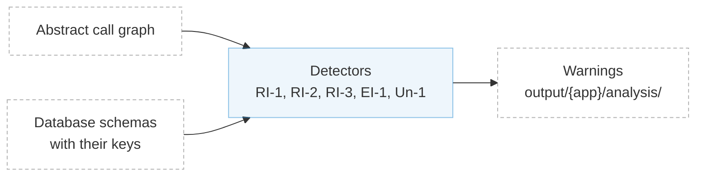

# Pattern Detection

## Overview

```mermaid
--8<-- "docs/snippets/pipeline.mmd"
    class detect current
    class ssa,acg,schema step
```

The final step traverses the [abstract call graph](inter-microservice-analysis.md) of each request, locating the database operations and checking them against the five patterns described in [What Aletheia Detects](../patterns.md), based on the constraints from [schema extraction](schema-extraction.md). Aletheia reports a warning for each match.



See [Usage → Read Detection Warnings](../usage/reading-warnings.md) for how to interpret the warnings.
