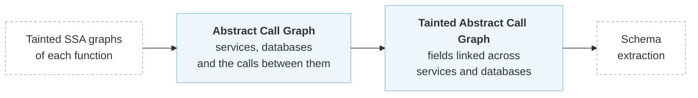
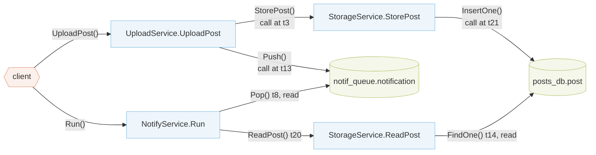
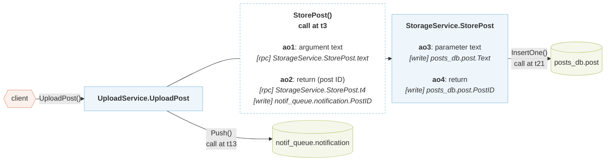
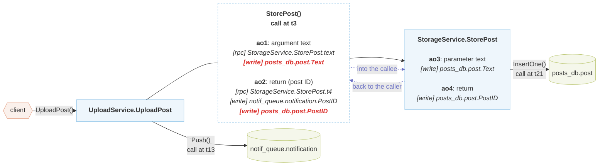

# Inter-microservice Analysis

## Overview

```mermaid
--8<-- "docs/snippets/pipeline.mmd"
    class acg current
    class ssa,schema,detect step
```

The [intra-procedural analysis](intra-procedural-analysis.md) only captures the flow of values within each service. In postnotification, for instance, it finds that `StorageService.StorePost` writes its returned post ID to `posts_db.post.PostID`, and that `UploadService.UploadPost` pushes the ID returned by `StorePost` to `notif_queue.notification.PostID`. The inter-microservice analysis establishes that both operations use the same value.

To this end, Aletheia builds an **abstract call graph**, which only retains the service invocations and database operations of each service, along with the values involved in them and their taints.



The diagram below depicts the services and databases of postnotification and the invocations between them, each labeled with its timestamp (the SSA name of the call). Each path from the client corresponds to one client request:



`NotifyService.Run` is a background service that pops the notifications pushed by `UploadPost`. Aletheia does not traverse `Run` on its own, but as a new request whenever another request pushes a message to its queue.

### Building the Abstract Call Graph

The nodes of the abstract call graph are service methods (e.g., `StorageService.StorePost`) and databases (e.g., `posts_db.post`), under a `client` root node, and its edges are:

- from the client to a service method, for each **entry point** of the application
- between two service methods, for each remote **service invocation**
- from a service method to a database, for each **database operation**, along with its type (write, update, read, or delete)

The diagram below depicts the **abstract call graph** of the `UploadPost()` request, with four of the values involved in its invocations. The dashed box is the edge of the invocation of `StorePost`:



These values are **abstract objects**, which hold their taints from the intra-procedural analysis. The parameters and return values of a method are attached to its node, while the arguments and return values at a call site are attached to the edge of the call. Here, `ao1` and `ao2` belong to the edge of the invocation of `StorePost`, and `ao3` and `ao4` to its node.

### Tainting the Abstract Call Graph

Aletheia then traverses the graph from each entry point, once per client request, following each call in depth to propagate taints across services:

- **Into the callee.** The taints of each argument at the call site are propagated to the corresponding parameter of the callee method declaration.
- **Back to the caller.** After visiting the callee, the taints of its parameters and return values are propagated back to the corresponding arguments and return values at the call site.

An object that acquires new taints propagates them to the subsequent calls into which it flows. Whenever an object holds taints from two different databases, the same value is stored in both, which [schema extraction](schema-extraction.md) turns into a foreign key.

The **interactive** diagram below depicts the traversal of the `UploadPost()` request. Taints in bold red are added at each step, and dotted violet arrows show taint propagation, not edges of the graph.

<div class="diagram-steps" markdown>



1. The traversal begins at `UploadService.UploadPost`. Initially, the edge of the invocation of `StorePost` holds the taints from `UploadPost`, where the text (`ao1`) is only passed to `StorePost` and the returned post ID (`ao2`) is pushed to the queue. The node of `StorePost` holds the taints from `StorePost`, which writes the text (`ao3`) and the returned post ID (`ao4`) to `posts_db`.
2. Into the callee, the taints of `ao1` are propagated to `ao3`, which acquires nothing new, since `UploadPost` does not store the text anywhere.
3. Back to the caller, the taints of `ao3` and `ao4` are propagated to `ao1` and `ao2`, showing that `StorePost` wrote the text and the post ID to `posts_db` at `t3`, before `UploadPost` pushes the post ID to the queue at `t13`.
4. `ao2` now holds writes to two databases, which it links through the post ID. From this link, [schema extraction](schema-extraction.md) infers that `notif_queue.notification.PostID` references `posts_db.post.PostID`.

</div>

The traversal then follows the queue into `NotifyService.Run`, where the popped notification acquires the taints of the pushed one. `Run` then uses the post ID from the notification to read the post, which, combined with the foreign key on the post ID, matches pattern [RI-3](../patterns.md#ri-3-referential-integrity-uncoordinated-replication).
