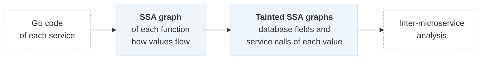
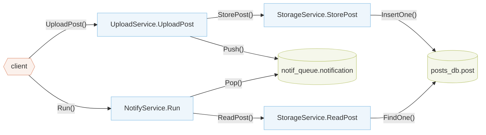
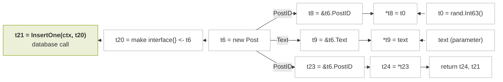
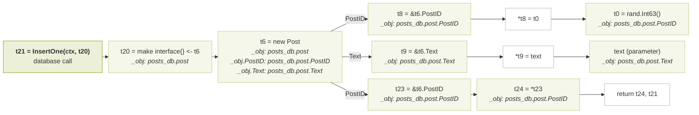

# Intra-procedural Analysis

## Overview

```mermaid
--8<-- "docs/snippets/pipeline.mmd"
    class ssa current
    class acg,schema,detect step
```

Aletheia first determines, within each function, which **database fields** each value is written to or read from, and which **service invocations** it is passed to or returned from. To this end, it builds an **SSA graph** for each function and **taints** it, i.e., it annotates the values used in database operations and service invocations and propagates these annotations to all reachable nodes.



> [!NOTE]
> Applications described by an [abstract model](../app-registry/abstract-model.md#guidelines-for-writing-abstract-models) skip this step, since the abstract model already specifies, for each function, its calls along with the taints of their arguments and return values.

This step is illustrated with the postnotification application from Antipode[^antipode] (`blueprint/examples/postnotification/`), where the Upload Service stores each post through the Storage Service and pushes a notification to a queue, from which the Notify Service reads the post back:



### Building SSA Graphs

Aletheia obtains the SSA representation of each function through the [Go SSA package](https://pkg.go.dev/golang.org/x/tools/go/ssa), in which each assignment creates a new version of a variable, named `t0`, `t1`, and so on.

For instance, `StorageService.StorePost` creates a post with a random post ID and the received text, writes it to `posts_db`, and returns the post ID (error handling and other fields omitted):

```go title="blueprint/examples/postnotification/workflow/postnotification/StorageService.go" hl_lines="2 4 5 10 11"
func (s *StorageServiceImpl) StorePost(ctx context.Context, reqID int64, text string) (int64, error) {
	postID := rand.Int63()
	post := &Post{
		PostID: postID,
		Text:   text,
		// ...
	}

	collection, err := s.postsDb.GetCollection(ctx, "posts_db", "post")
	err = collection.InsertOne(ctx, post)
	return post.PostID, err
}
```

In its SSA representation, the struct literal becomes an allocation (`t6`), the address of each field (`t8`, `t9`), and a store into each field (`*t8`, `*t9`), while reading `post.PostID` takes the address of the field again (`t23`) and loads its value (`t24`):

```txt hl_lines="2 3 4 5 6 11 12"
t0 = math/rand.Int63()
t6 = new Post (complit)
t8 = &t6.PostID [#1]
t9 = &t6.Text [#3]
*t8 = t0
*t9 = text
...
t20 = make interface{} <- *Post (t6)
t21 = invoke t17.InsertOne(ctx, t20)
...
t23 = &t6.PostID [#1]
t24 = *t23
return t24, t21
```

Aletheia then builds one graph per function, with a node per SSA instruction and edges that follow the data. Edges go from a struct to its field addresses, from an address and a value to the store between them, from an address to the value loaded from it, and from an argument to its call. The **SSA graph** of `StorePost` before tainting is depicted below:



The remaining fields of the post and the instructions that obtain the collection are omitted.

### Tainting SSA Graphs

Aletheia then taints the SSA graphs in three steps:

1. It identifies the nodes of **database operations** (e.g., `InsertOne` on a NoSQL collection, `Exec` on a relational database, or `Push` on a queue) and **service invocations** (calls on a field that holds another service).
2. It annotates their arguments and return values with a **taint**, either a **database taint** or a **service taint**.
3. It propagates each taint to all reachable nodes in the graph.

> [!TIP]
> See [Taint Representation](taint-representation.md) for how database taints and service taints are represented.

The **interactive** diagram below depicts the same SSA graph of `StorePost` after tainting.

<div class="diagram-steps" markdown>



1. The database operation `t21` writes the post to `posts_db.post`, so the taints originate at its argument `t20`.
2. Through the interface conversion, they reach the post `t6`, with a taint for the post and one for each of its fields.
3. Through the fields, they reach the field addresses `t8`, `t9`, and `t23`.
4. Through the stores, they reach the random post ID `t0` and the parameter `text`, which are the stored values.
5. Through the load from `t23`, they reach `t24`, the value returned by `StorePost`.

</div>

Each node shows the taints of its value below its instruction, and arrows represent the direction of taint propagation, which may go against the edges of the graph, as from `t20` back to `t6`.

Each taint is associated with an **object path** of the value, such as `_obj` for the value itself, `_obj.PostID` for one of its fields, and `_obj[*]` for the elements of a slice, which determines which fields of an object are stored in which database fields.

Service invocations originate taints in the same way. For instance, the post ID that `StorePost` returns to `UploadService.UploadPost` holds a service taint from that invocation and, since it is pushed in a message to the queue, a database taint from `Push`:

```go title="blueprint/examples/postnotification/workflow/postnotification/UploadService.go" hl_lines="3 5 6 9"
func (u *UploadServiceImpl) UploadPost(ctx context.Context, username string, text string) (int64, error) {
	reqID := rand.Int63()
	postID, _ := u.storageService.StorePost(ctx, reqID, text) // ← service taint (StorePost)

	message := Message{
		PostID: postID, // ← stored in the message
		// ...
	}
	_, err := u.notificationsQueue.Push(ctx, message) // ← database taint (notification.PostID)
	return postID, nil
}
```

### Calls Within a Service

Calls to helper methods of the same service, such as digota's `OrderService.storageGetOne`, are analyzed by copying the graph of the helper into each call site and propagating taints between the arguments and return values of the call and the parameters and return values of the helper. Calls to other services are not followed, so each service is analyzed in isolation.

### Values at Service Boundaries

The [inter-microservice analysis](inter-microservice-analysis.md) only requires the final taints of the values that cross service boundaries, i.e., the parameters and return values of each service method and the arguments and return values of its calls. For the two methods above:

| Method | Value | Taints |
| ------ | ----- | ------ |
| `StorageService.StorePost(ctx context.Context, reqID int64, text string) (int64, error)` | parameter `text` | `[write] [t21] @ posts_db.post.Text` |
| `StorageService.StorePost(ctx context.Context, reqID int64, text string) (int64, error)` | return | `[write] [t21] @ posts_db.post.PostID` |
| `UploadService.UploadPost(ctx context.Context, username string, text string) (int64, error)` | argument `text` of `StorePost()` | `[rpc] [t3] @ StorageService.StorePost.text` |
| `UploadService.UploadPost(ctx context.Context, username string, text string) (int64, error)` | return of `StorePost()` | `[rpc] [t3] @ StorageService.StorePost.t4`<br/>`[write] [t13] @ notif_queue.notification.PostID` |

Neither method is aware of the database of the other. The inter-microservice analysis connects them through the invocation of `StorePost`.

[^antipode]: João Ferreira Loff, Daniel Porto, João Garcia, Jonathan Mace, and Rodrigo Rodrigues. Antipode: Enforcing Cross-Service Causal Consistency in Distributed Applications. In *Proceedings of the 29th Symposium on Operating Systems Principles (SOSP '23)*, pages 298–313, 2023. <https://doi.org/10.1145/3600006.3613176>
