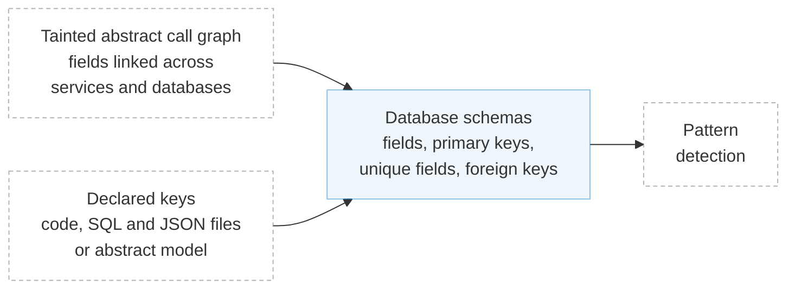
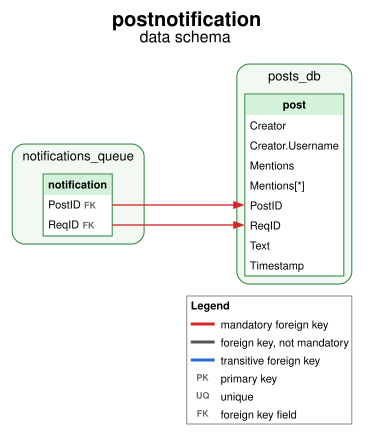

# Schema Extraction

## Overview

```mermaid
--8<-- "docs/snippets/pipeline.mmd"
    class schema current
    class ssa,acg,detect step
```

The third step extracts the schema of each database, comprising its tables, their fields, and their integrity constraints. These are foreign keys for referential integrity (RI-1, RI-2, and RI-3), primary keys for entity integrity (EI-1), and unique fields for uniqueness (Un-1).

Aletheia obtains the declared primary keys and unique fields from the code and schema files, and infers foreign keys from the fields linked across databases during the [inter-microservice analysis](inter-microservice-analysis.md#tainting-the-abstract-call-graph).



### Tables and Fields

Aletheia describes every database in relational terms, where a table may also be a collection, a cache namespace, or a queue topic. Each database has one **schema** per table, denoted `<database>.<schema>` (e.g., `posts_db.post`), whose **fields** are named after their object path, including nested fields and list elements (e.g., `posts_db.post.Creator.Username` and `posts_db.post.Mentions[*]`).

The fields are collected from the database taints of the arguments of each database operation, so fields that are never written or read are not included. For instance, `StorageService.StorePost` writes an entire `Post` with `InsertOne`, which adds all its fields to `posts_db.post`. For postnotification:

| Schema | Fields |
| ------ | ------ |
| `posts_db.post` | `PostID`, `ReqID`, `Text`, `Mentions[*]`, `Creator.Username`, `Timestamp` |
| `notif_queue.notification` | `PostID`, `ReqID` |

### Primary Keys and Unique Fields

Primary keys and unique fields are declared in each database. For applications written in Blueprint, Aletheia obtains them from the `bson:"_id"` tags of the documents inserted by the code and from the SQL and JSON schema files registered in `registry/apps.yaml`. For applications described by an [abstract model](../app-registry/abstract-model.md#guidelines-for-writing-abstract-models), they are obtained from the abstract model:

| Source | Primary keys | Unique fields |
| ------ | ------------ | ------------- |
| Documents that the code inserts with `InsertOne` (see [App Registry → Register Blueprint Application](../app-registry/blueprint-application.md#schema-fields)) | Fields tagged `bson:"_id"` | |
| SQL files listed in `sql_tables` | `PRIMARY KEY` columns of each `CREATE TABLE` | `UNIQUE` columns |
| JSON schema files in the `database` folder under `nosql_path` | | Fields listed in `uniqueItems` |
| [Abstract model](../app-registry/abstract-model.md#databases) | `primary_key` of each schema | `unique` of each schema |

See [App Registry → Register Blueprint Application](../app-registry/blueprint-application.md) for how to declare `sql_tables` and `nosql_path`.

For instance, in dsb_mediamicroservices, `MovieIdService` stores movies whose ID is tagged with `bson:"_id"`, and `database/movie_id_db.json` declares their title as unique:

``` { .txt .warnings title="output/dsb_mediamicroservices/constraints.txt" }
PRIMARY KEY (movie_id_db.movie._id)
UNIQUE (movie_id_db.movie.Title)
```

These constraints lead to the [EI-1](../patterns.md#ei-1-entity-integrity-uncoordinated-replication) and [Un-1](../patterns.md#un-1-uniqueness-conflicting-writes) violations that Aletheia reports for dsb_mediamicroservices.

### Inferring Foreign Keys

To find foreign keys that are not declared, Aletheia looks for abstract objects that hold taints from operations on two different databases during the [traversal of each request](inter-microservice-analysis.md#tainting-the-abstract-call-graph). Since each taint identifies the field, the operation, and when it occurs, this determines the two fields that the value links. Fields of the same database are never linked.

To determine which field references the other, Aletheia denotes each pair of operations as an ordered tuple (`op1`, `op2`), following their order in the request, with `field1` and `field2` the fields accessed in each, and applies one of five rules based on the type of each operation.

A **write** is any mutating operation, such as an insert or an update. A **read** is either a **read key**, when the value is used to look up records (e.g., a filter value or a cache key), or a **read value**, when the value is part of the result. Deletes do not create foreign keys.

The type is associated with each use of a value. For instance, in dsb_hotel, `ProfileService.GetProfiles` looks up the profile of each hotel in a cache and, if it is not cached, reads it from a NoSQL database and adds it to the cache:

```go title="blueprint/examples/dsb_hotel/workflow/hotelreservation/ProfileService.go" hl_lines="1 3"
exists, err := p.profileCache.Get(ctx, hid, &profile) // ← hid: read key, profile: read value
...
err = p.profileCache.Put(ctx, hid, profile)           // ← hid and profile: writes
```

Here, `hid` is a read key in `Get` and a write in `Put`, whereas `profile` is a read value in `Get` and a write in `Put`. The same applies to other storage systems:

| Storage | Write | Read key | Read value |
| ------- | ----- | -------- | ---------- |
| NoSQL database | Document of `InsertOne` | Filter values of `FindOne` | Document read by `One` |
| Relational database | Values of an `INSERT` | Arguments of the `WHERE` clause of `Select` or `Get` | Destination of `Select` or `Get` |
| Cache | Key and value of `Put` | Key of `Get` | Value read by `Get` |
| Queue | Message of `Push` | | Message of `Pop` |

Aletheia then applies the following rules:

| Rule | `op1` | `op2` | Foreign key | Why |
| ---- | ----- | ----- | ----------- | --- |
| 1 | read | write | `field2` references `field1` | The write inserts a reference to the record that was read |
| 2 | write | read key | `field1` references `field2` | The write inserted a reference to the record that is read |
| 3 | write | write | `field2` references `field1` | Both records are written in the same request, so the second write inserts a reference to the first, which has just been created |
| 4 | read value | read key | `field1` references `field2` | The value retrieved by the first read is subsequently used as a foreign key to look up the second record |
| 5 | read key | read key | `field2` references `field1` | The first read retrieves the referenced record directly using a foreign key, while the second looks up the record holding that foreign key |

Rule ④ is disabled by default and can be enabled with `CreateReferencesFromReadReadPairAndValKey` in [`internal/config/config.go`](https://github.com/aletheia-microservices/aletheia/blob/main/internal/config/config.go).

For instance, in eshopmicroservices, `WebApp.OnPostAddToCartAsync` reads a product from `catalog_db` and then stores its ID, name, and price in a basket in `basket_db`, so, by rule ①, the basket items reference the product:

``` { .txt .warnings title="output/eshopmicroservices/constraints.txt" }
FOREIGN_KEY basket_db.basket.Items[*].ProductId REFERENCES catalog_db.product.Id
FOREIGN_KEY basket_db.basket.Items[*].ProductName REFERENCES catalog_db.product.Name
FOREIGN_KEY basket_db.basket.Items[*].Price REFERENCES catalog_db.product.Price
```

Aletheia also tags some foreign keys in its output:

- **Mandatory** (`[MANDATORY]`): every request that stores the reference also writes the referenced record, as in rule ③, which is the setting of [RI-3](../patterns.md#ri-3-referential-integrity-uncoordinated-replication).
- **Transitive** (`[T]`): the foreign key pointed to a field that already references a third field, so Aletheia redirected it to that third field.

### Example: Post Notification

After the [inter-microservice analysis](inter-microservice-analysis.md#tainting-the-abstract-call-graph), the post ID returned by `StorageService.StorePost` (`ao2`) holds taints from two databases:

```txt
[write] [t3] @ posts_db.post.PostID
[write] [t13] @ notif_queue.notification.PostID
```

1. The two taints are on different databases, so the post ID links `posts_db.post.PostID` and `notif_queue.notification.PostID`.
2. `op1` is the write of the post during the invocation of `StorePost` at `t3`, and `op2` is the push of the notification at `t13`.
3. Both are writes, so, by rule ③, the notification references the post that the same request has just created.
4. Every request that pushes the notification also writes the post, so the foreign key is mandatory.

The request ID yields a foreign key in the same way. Aletheia saves the schemas in `output/{app}/schema.json` and the constraints, one per line, in `output/{app}/constraints.txt`:

``` { .txt .warnings title="output/postnotification/constraints.txt" }
FOREIGN_KEY notif_queue.notification.PostID REFERENCES posts_db.post.PostID [MANDATORY]
FOREIGN_KEY notif_queue.notification.ReqID REFERENCES posts_db.post.ReqID [MANDATORY]
```

The [schema diagram](../usage/diagrams.md#schema-diagram) script renders `schema.json` as an image:



### Limitations

The limitations of Aletheia, including those of foreign key inference, are discussed in detail in [Section 6 of the paper](https://www.usenix.org/system/files/osdi26-ferreira.pdf).

To prevent Aletheia from inferring a specific foreign key, its referencing field can be listed in `ignore_foreignkeys` (see [Usage → Suppress Detection Warnings](../usage/suppressing-warnings.md)).

The next step, [pattern detection](detection-of-problematic-patterns.md), searches for operations that may violate these constraints, such as the mandatory foreign key on the post ID, which leads to the [RI-3](../patterns.md#ri-3-referential-integrity-uncoordinated-replication) violation in postnotification.
