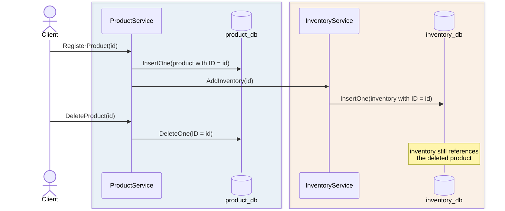
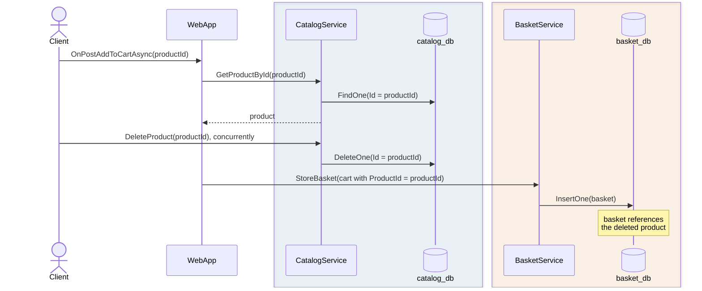
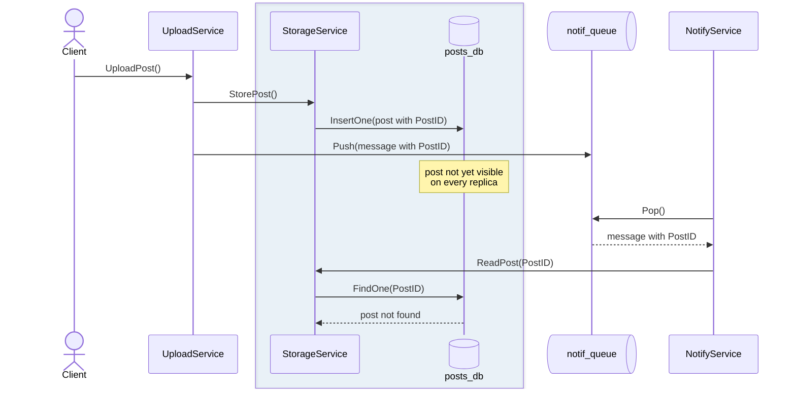
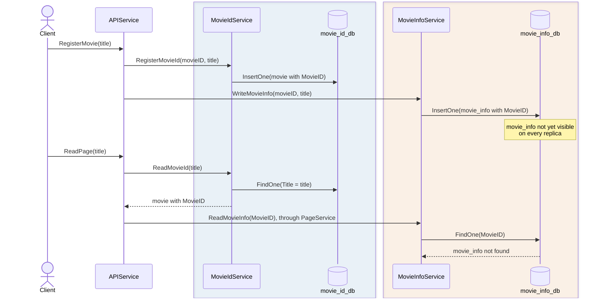
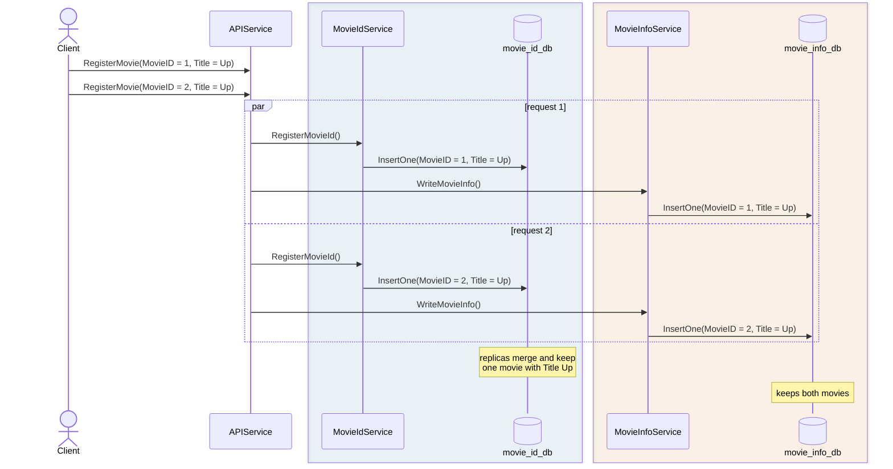

# What Aletheia Detects

This page gives a quick, practical overview of the five patterns of operations that Aletheia searches for in the code. Each pattern is formalized in Section 3 of our paper and illustrated in its Figure 2.

| ID | Constraint | Pattern | Definition |
| -- | ---------- | ------- | ---------- |
| [RI-1](#ri-1-referential-integrity-absence-of-cascading-deletes) | Referential integrity | Absence of cascading deletes | A request deletes a record but not the records in other databases that reference it. |
| [RI-2](#ri-2-referential-integrity-concurrent-operations) | Referential integrity | Concurrent operations | A request stores a reference to a record while a concurrent request deletes that record. |
| [RI-3](#ri-3-referential-integrity-uncoordinated-replication) | Referential integrity | Uncoordinated replication | A request writes a record and a reference to it in different databases, and another request sees the reference before the record. |
| [EI-1](#ei-1-entity-integrity-uncoordinated-replication) | Entity integrity | Uncoordinated replication | A request splits an entity across two databases under the same primary key, and another request finds it in only one of them. |
| [Un-1](#un-1-uniqueness-conflicting-writes) | Uniqueness | Conflicting writes | Two concurrent requests write the same unique value: one database keeps one write when replicas merge, another keeps both. |

The sections below describe each pattern with an example application: a diagram shows how the example breaks the constraint, and a collapsible block shows its code.

## RI-1: Referential integrity, absence of cascading deletes

A request deletes a record in one database but not the records in other databases that reference it, so they point to a record that no longer exists.

_Example (`simpleshop`):_ `ProductService.DeleteProduct()` deletes a product from `product_db` but leaves its record in `inventory_db`.



<details markdown>
<summary>Code: <code>ProductService.RegisterProduct()</code> and <code>ProductService.DeleteProduct()</code></summary>

```go title="blueprint/examples/simpleshop/workflow/simpleshop/ProductService.go" linenums="30" hl_lines="12 17 29"
--8<-- "blueprint/examples/simpleshop/workflow/simpleshop/ProductService.go:30:59"
```

</details>

## RI-2: Referential integrity, concurrent operations

One request reads a record and stores a reference to it in another database, while a concurrent request deletes that record.

_Example (`eshopmicroservices`):_ `BasketService.StoreBasket()` saves product IDs in `basket_db` while `CatalogService.DeleteProduct()` can delete those products from `catalog_db` at the same time.



<details markdown>
<summary>Code: <code>WebApp.OnPostAddToCartAsync()</code> and <code>CatalogService.DeleteProduct()</code></summary>

```go title="blueprint/examples/eshopmicroservices/workflow/web/webapp.go" linenums="134" hl_lines="2 13 20"
--8<-- "blueprint/examples/eshopmicroservices/workflow/web/webapp.go:134:159"
```

```go title="blueprint/examples/eshopmicroservices/workflow/catalog/catalog_service.go" linenums="83" hl_lines="7"
--8<-- "blueprint/examples/eshopmicroservices/workflow/catalog/catalog_service.go:83:90"
```

</details>

## RI-3: Referential integrity, uncoordinated replication

A request writes a record to one database and a reference to it in another. Because the databases replicate independently, another request can see the reference before the record it points to.

_Example (`postnotification`):_ `UploadService.UploadPost()` saves a post in `posts_db` and pushes a notification with its `PostID` to `notif_queue`. `NotifyService` can read the notification before the post is visible.



<details markdown>
<summary>Code: <code>UploadService.UploadPost()</code> and <code>NotifyService.Run()</code></summary>

```go title="blueprint/examples/postnotification/workflow/postnotification/UploadService.go" linenums="24" hl_lines="3 9"
--8<-- "blueprint/examples/postnotification/workflow/postnotification/UploadService.go:24:37"
```

```go title="blueprint/examples/postnotification/workflow/postnotification/NotifyService.go" linenums="24" hl_lines="8 15"
--8<-- "blueprint/examples/postnotification/workflow/postnotification/NotifyService.go:24:42"
```

</details>

## EI-1: Entity integrity, uncoordinated replication

A request splits one entity across two databases under the same primary key. Another request that reads both by that key can find the entity in one database but not yet in the other.

_Example (`dsb_mediamicroservices`):_ `APIService.RegisterMovie()` saves each movie in `movie_id_db` and `movie_info_db` under the same `MovieID`, and `APIService.ReadPage()` can find it in only one of them.



<details markdown>
<summary>Code: <code>APIService.RegisterMovie()</code> and <code>APIService.ReadPage()</code></summary>

```go title="blueprint/examples/dsb_mediamicroservices/workflow/mediamicroservices/APIService.go" linenums="73" hl_lines="23 28 38 43"
--8<-- "blueprint/examples/dsb_mediamicroservices/workflow/mediamicroservices/APIService.go:73:121"
```

</details>

## Un-1: Uniqueness, conflicting writes

A request writes a unique value to one database and related data to another. If the databases are replicated and two requests write the same unique value concurrently, the first database keeps only one write when replicas merge, but the second keeps both.

_Example (`dsb_mediamicroservices`):_ two concurrent `APIService.RegisterMovie()` calls with the same `Title` can leave one movie in `movie_id_db`, where `Title` is unique, but two in `movie_info_db`.



<details markdown>
<summary>Code: <code>APIService.RegisterMovie()</code> and the uniqueness constraint on <code>Title</code></summary>

```go title="blueprint/examples/dsb_mediamicroservices/workflow/mediamicroservices/APIService.go" linenums="95" hl_lines="1 6"
--8<-- "blueprint/examples/dsb_mediamicroservices/workflow/mediamicroservices/APIService.go:95:104"
```

```json title="blueprint/examples/dsb_mediamicroservices/workflow/mediamicroservices/database/movie_id_db.json" hl_lines="6-8"
--8<-- "blueprint/examples/dsb_mediamicroservices/workflow/mediamicroservices/database/movie_id_db.json"
```

</details>
